{: .no_toc }

# Figma & AI

**Figma Make** is an AI-powered app-building tool. You describe what you want in ordinary language, and AI generates a working, interactive prototype without requiring coding skills. You can test the prototype, ask AI to make changes and share the result with others.

Traditionally, Figma focuses on designing how an app looks. **Figma Make** moves towards building something users can interact with.

For UX projects, tools such as **ChatGPT** and **Claude **offer an alternative approach. They generate working prototypes through AI-assisted coding, often providing a quicker route to testing ideas with users and gathering feedback. Rather than focusing solely on design tools, you should consider which approach best supports rapid prototyping and user testing.

Sources: [Figma Make](https://help.figma.com/hc/en-us/articles/31304412302231-Explore-Figma-Make?utm_source=chatgpt.com) | [Claude Artifacts](https://www.anthropic.com/news/artifacts?utm_source=chatgpt.com) | [ChatGPT](https://openai.com/chatgpt/?utm_source=chatgpt.com).


####  Copy a UI Screen-Capture & Convert to a Figma Design File

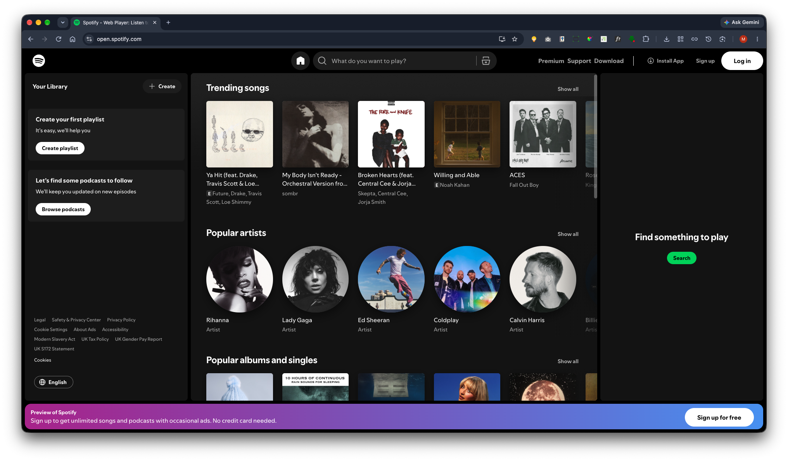

Open a folder or create a new one. Then go to the blue Create button and select Make.

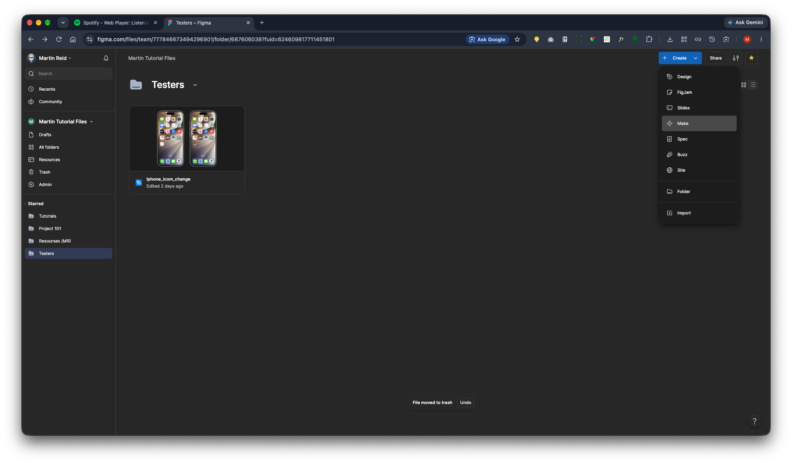

You will be prompted to add an attachment. Alternatively, click the plus (+) icon in the bottom-left corner of the chat field.

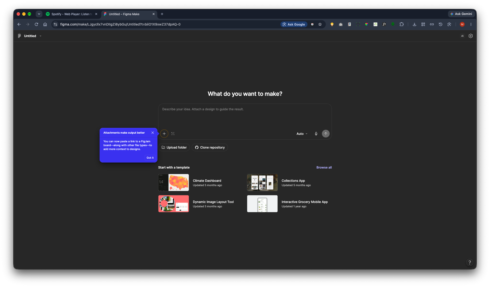

Then select Upload File/s.

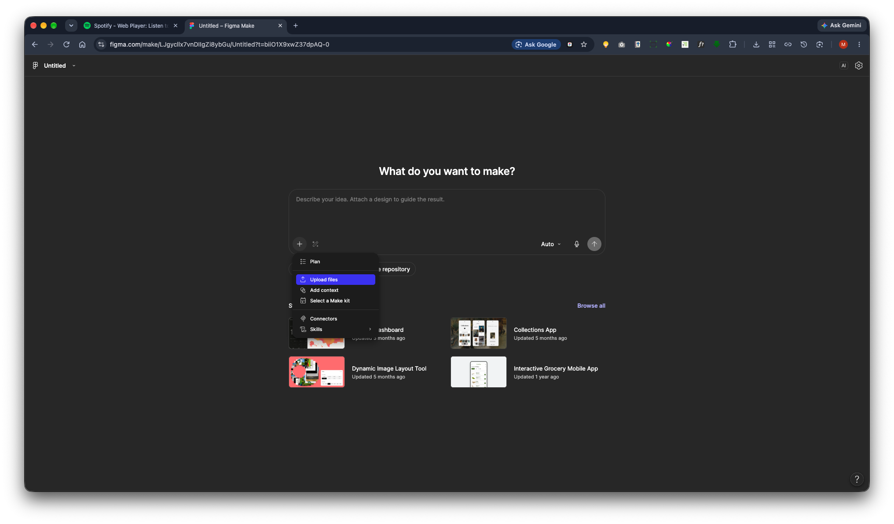

I have already taken a screenshot. I will browse to the file I want to use, select it, and click Open.

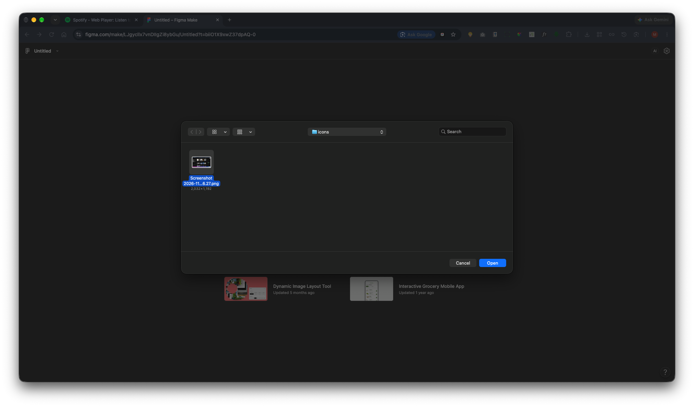

Now I will provide instructions. Type "Recreate this" and click the Send button in the bottom-right corner of the chat.

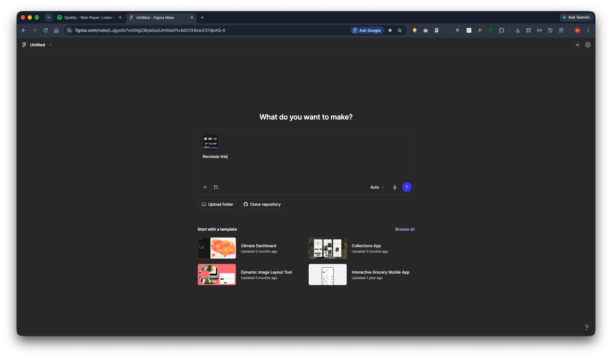

Figma will begin using AI to recreate the screen capture. It will document its progress in the left-hand panel.

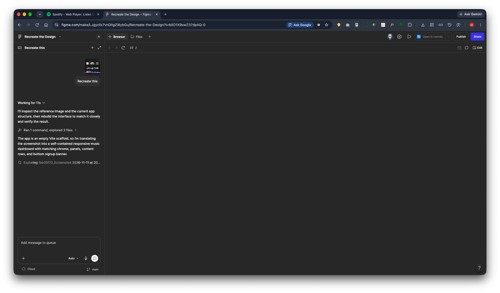

Once completed, the design will appear on the canvas. This will include all the components and interactions. As I have copied Spotify, Sigma will replace the original images with Creative Commons Zero (CC0) images from Unsplash that are available in the public domain.

Now go to the top-left corner and click the Preview button. 
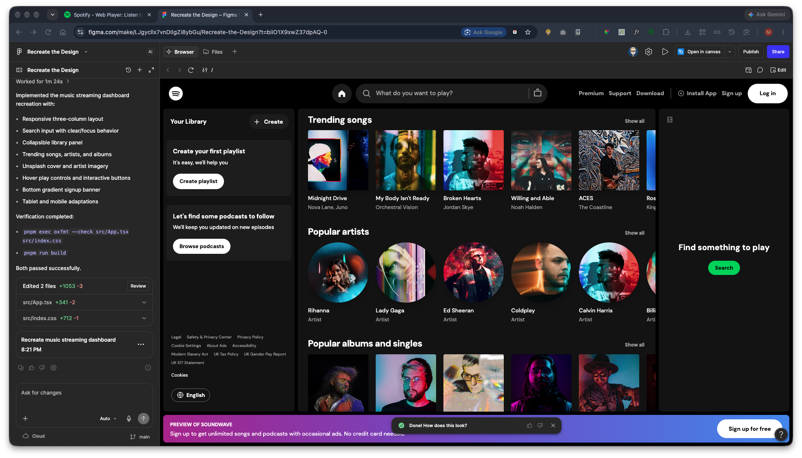

This will open the preview in a new browser tab.


Next, click Copy Design.

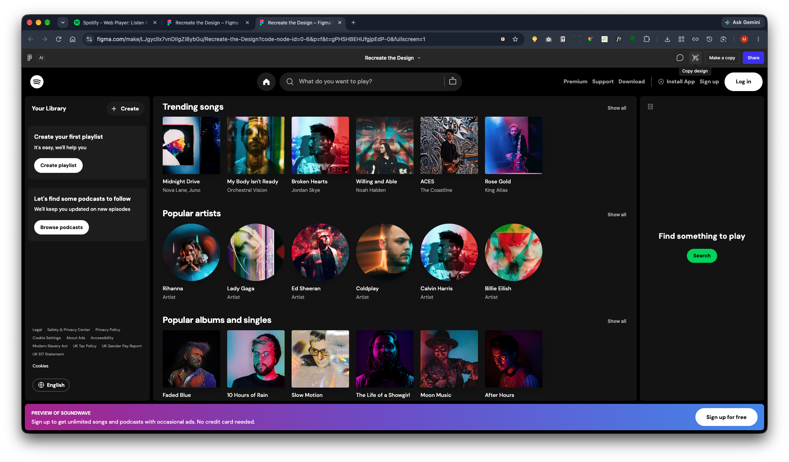

#### Paste into a Design File 

Now return to your files by clicking the Figma icon in the top-left corner. Then navigate to your folder and create a new Figma design file.

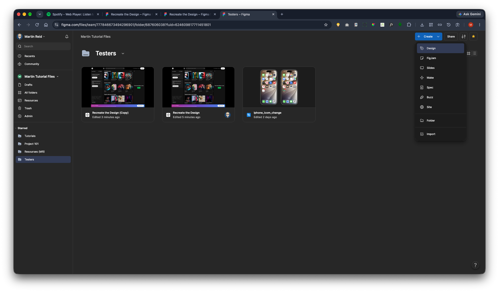


Right-mouse Click on the canvas and select Paste Here.

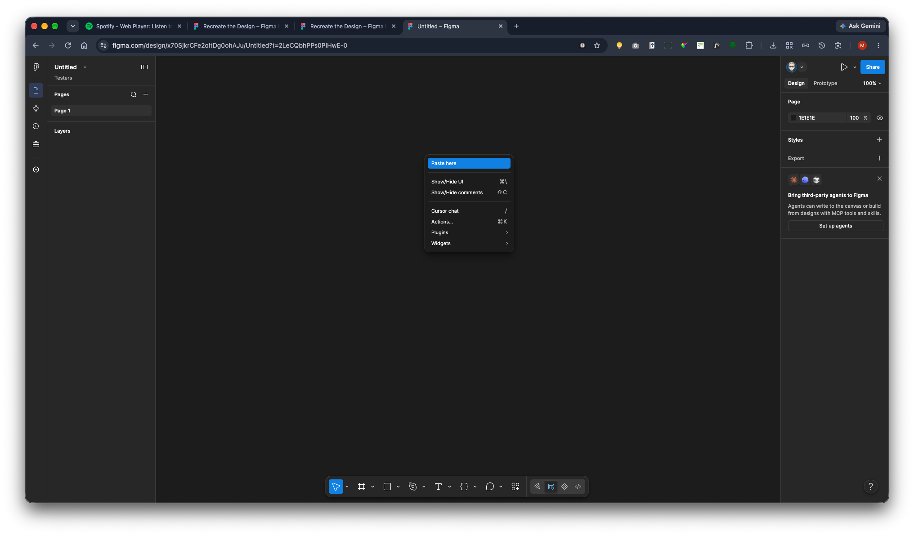

The design will now appear.

It is now fully editable. You may need to capture additional screens for other pages that you want to link together when creating your prototype.

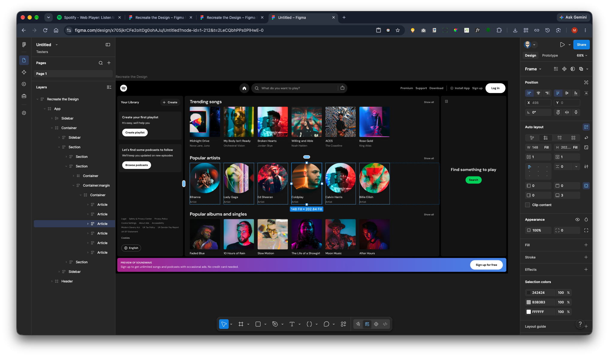


### Figma Make with a AI Chat Prompt

We’re now going to create a prompt, either directly in the Figma Make AI chat window or in another AI platform and then copy and paste it into Figma Make.

It’s important to have a clear idea of what you want to achieve with your application before you start. When creating an app, you need to understand exactly what its purpose is and how you want it to be implemented.

Bear in mind that generating screens with AI can consume a significant number of tokens. The more screens and features you ask it to create, the more tokens it will use. If it runs out of tokens, you may need to return and continue the work in a new session.

Create a new paper to make.

AAI Platform. I'm exploring it too. Great. It offers a prompt-based approach, built around the application you want to create.

You can simply explain what you want, provide your requirements, and enter your name.

It will read your prompt and start building your application.

Once completed, you may need to refine and apply a few changes, but it will generate an interactive prototype that you can publish and share using a link.

```
Create a polished, production-quality mobile app prototype called “Leaflet,” a friendly plant-care app for beginners.

IMPORTANT OUTPUT AND COPY REQUIREMENTS

The final result must contain three connected screens, but only ONE screen may be visible in the preview at a time.

Do not:
- Display the screens side by side
- Create a horizontal storyboard
- Put the screens inside decorative device mockups
- Add labels, headings, margins, padding, or controls outside the mobile screen
- Scale the mobile screen larger than the preview viewport
- render multiple screens simultaneously in the DOM

The preview must initially show Screen 1: My Plants.

Use three distinct application views:
1. My Plants
2. Plant Detail
3. Add a Plant

Navigation must replace the current view instead of placing the next screen beside or underneath it.

MOBILE CANVAS

Design each view for an iPhone 14 viewport:
- Width: 390px
- Height: 844px
- No outer margin or padding
- No decorative browser or phone chrome
- No content outside the 390 × 844 app canvas
- Use width: 100% with max-width: 390px so the design does not get cut off in a narrower preview
- Center the app only when the browser viewport is wider than 390px
- The application canvas must have height: 844px
- Each screen must manage its own vertical scrolling inside the app canvas
- Prevent horizontal scrolling and horizontal overflow
- The page background outside the canvas may be stone-200, but it must not introduce spacing around the canvas on a mobile viewport

Use a single-screen router or React state:
- “home” renders only My Plants
- “detail” renders only Plant Detail
- “add” renders only Add a Plant

Do not keep inactive screens positioned off-canvas. Inactive screens should not be rendered. This is important so Figma copies only the currently visible screen.

TECHNOLOGY

Use:
- React
- Vite
- Tailwind CSS
- Tailwind utility classes
- Tailwind’s default scales for color, spacing, typography, radius, and shadow
- Inter
- Lucide icons at 24px with a 2px stroke

Do not invent arbitrary design-token values. The explicit 390 × 844 screen dimensions are allowed because they are the required device dimensions.

DESIGN TOKENS

Colors:
- Primary: green-600
- Primary hover and pressed: green-700
- Primary tints: green-50 and green-100
- Page background: stone-50
- Cards: white
- Headings: stone-900
- Body copy: stone-600
- Borders: stone-200
- Watering: sky-500
- Light: amber-500
- Urgent or overdue: rose-500

Typography:
- Font: Inter
- Main headings: text-2xl font-semibold
- Section headings: text-xl font-semibold
- Body: text-base
- Captions: text-sm text-stone-600

Components:
- Cards: rounded-2xl bg-white shadow-sm
- Primary buttons: rounded-xl bg-green-600 text-white
- Primary button hover and pressed: green-700
- Secondary buttons: rounded-xl border border-stone-200 bg-white
- Chips and badges: rounded-full
- Page padding: px-4
- Card spacing: gap-4
- Minimum interactive target: 44 × 44px
- Maintain WCAG AA contrast
- Use visible keyboard focus states

Use shared components for:
- PrimaryButton
- SecondaryButton
- StatusBadge
- PlantCard
- IconButton
- BottomTabBar

PHOTOGRAPHY

Use realistic, high-quality houseplant photography. Select images appropriate to:
- Monstera deliciosa
- Pilea peperomioides
- Snake plant
- Heartleaf philodendron

Use intentional object-fit and object-position settings. Do not use gradients, illustrations, or abstract placeholders in place of the plant photos.

SCREEN 1 — MY PLANTS

This must be the initial screen shown in Preview.

Header:
- Small caption: “Welcome back”
- Main greeting: “Good morning, Sam”
- Small circular avatar with initials “SA”

Today’s care:
- Green-50 summary card
- Watering icon
- Heading: “Today’s care”
- Supporting text: “3 plants need water”
- Full-width primary button: “Start care round”

Filters:
- Horizontally scrollable chip row
- Chips: “All,” “Needs water,” “Low light,” and “Pet-safe”
- “All” selected by default
- Selected chip: green-600 background with white text
- Unselected chips: white background, stone border, dark readable text
- Tapping a chip updates its selected state
- The chip row may scroll horizontally, but the overall page must never scroll horizontally

Plant collection:
- Section title: “My plants”
- Supporting count: “6 plants”
- Two-column card grid
- Four visible plant cards with realistic content:
  1. Monty — Monstera deliciosa — Water today
  2. Penny — Pilea peperomioides — Overdue
  3. Spike — Dracaena trifasciata — Happy
  4. Lola — Philodendron hederaceum — Water today
- Each card contains:
  - Rounded plant photo
  - Plant name
  - Species caption
  - Status badge
- Status badge colors:
  - Water today: sky
  - Overdue: rose
  - Happy: green

Bottom navigation:
- Four tabs: Plants, Schedule, Discover, Profile
- Plants is active
- Use Lucide icons with labels
- Keep the navigation fixed inside the mobile screen while the content scrolls
- Do not attach it to the browser viewport outside the app canvas

Floating action:
- Green circular “+” button
- Centered above the bottom tab bar
- Keep it fixed inside the mobile screen while content scrolls
- Give it a minimum 44 × 44px touch target

Home scrolling:
- The Home content must scroll vertically within the 390 × 844 canvas
- The bottom tab bar and “+” button must stay visible while scrolling
- Add enough bottom padding to the scrolling content so the last plant card is not hidden behind the tab bar
- Do not show a permanent browser scrollbar over the content if it can be visually hidden without disabling scrolling
- Do not allow horizontal page movement

Home interactions:
- Tapping any plant card opens Screen 2: Plant Detail
- Tapping the floating “+” opens Screen 3: Add a Plant
- “Start care round” should have a pressed state; it does not need to open another screen
- Filter chips should visibly update their selected state

SCREEN 2 — PLANT DETAIL

This view must fully replace Screen 1 when a plant card is tapped.

Hero:
- Large Monstera photo at the top
- Circular back button over the upper-left of the photo
- Circular favourite button over the upper-right
- Tapping favourite toggles its selected state

Plant identity:
- Green health badge: “Thriving”
- Title: “Monstera deliciosa”
- Subtitle: “Living room · Bright indirect light”

Stats:
- Three equal tiles in one row
- Water — Every 7 days
- Light — Bright indirect
- Humidity — Medium
- Use sky, amber, and green icon accents respectively

Next up:
- White card
- Caption: “NEXT UP”
- Heading: “Water in 2 days”
- Watering icon
- Sky progress bar
- Supporting text: “5 days since the last watering”
- Full-width primary button: “Mark as watered”
- Tapping the button changes the card to:
  - Heading: “Watered today”
  - Supporting text: “Nice work — your schedule is updated.”
  - Full progress bar
  - Disabled button: “Watering logged”

Care history:
- Vertical timeline with three entries:
  1. Watered — May 18 — “Soil was dry 2 inches down”
  2. Misted leaves — May 14 — “Morning mist and leaf wipe”
  3. Repotted — April 26 — “Moved to a 10-inch terracotta pot”
- Each entry includes a colored circular icon, title, date, and note

Care tips:
- Two collapsed accordion rows:
  - “How much light does it need?”
  - “When should I repot?”
- Include chevron-down icons

Plant Detail scrolling:
- Allow vertical scrolling within the 390 × 844 canvas
- Keep the hero full width
- Do not introduce horizontal movement

Plant Detail navigation:
- Back returns to Screen 1: My Plants
- Returning Home should preserve the Home screen’s selected filter and scroll position when practical

SCREEN 3 — ADD A PLANT

This view must fully replace Screen 1 when the Home “+” button is tapped.

Progress:
- Back control at upper-left
- Text at upper-right: “Step 2 of 3”
- Progress bar at approximately two-thirds completion

Heading:
- “Where will your plant live?”
- Supporting copy: “We’ll tailor its care plan to the room and light.”

Room selector:
- Large tappable cards with icons:
  - Living room
  - Bedroom
  - Kitchen
  - Bathroom
  - Office
- Living room selected by default
- Selected card uses a visible green-600 two-pixel ring
- Unselected cards use stone-200 borders
- Tapping a card changes the selected room

Light level:
- Segmented control:
  - Low
  - Medium
  - Bright
- Bright selected by default
- Selected segment appears as a white raised segment with green text

Reminder:
- Toggle labeled “Remind me to water”
- Supporting text: “Get a gentle notification”
- Toggle enabled by default
- A reminder row below it:
  - Clock icon
  - “Reminder time”
  - “9:00 AM”
- Disabling the toggle visibly disables the reminder-time row

Sticky actions:
- Sticky bottom bar inside the 390 × 844 screen
- Secondary “Back” button
- Primary “Continue” button
- Add enough bottom padding so page content is not hidden behind the action bar

Add Plant navigation:
- Header Back returns to My Plants
- Bottom Back returns to My Plants
- Continue returns to My Plants for this prototype

COPYING EACH SCREEN INTO A FIGMA DESIGN FILE

The preview must begin on My Plants.

Copy Screen 1:
1. Open Preview and confirm My Plants is the only visible screen.
2. Return the Home page to its initial scroll position at the top.
3. Make sure the “All” filter is selected.
4. Use Figma Make’s “Copy design” action.
5. Open the destination Figma design file.
6. Paste the copied design.
7. Rename the pasted top-level frame “Leaflet / My Plants.”
8. Confirm the frame size is 390 × 844.
9. If the pasted frame is not exactly 390 × 844, resize the frame itself rather than scaling all child layers.

Copy Screen 2:
1. Return to Preview.
2. Tap the Monty or Monstera plant card.
3. Confirm Plant Detail is now the only visible screen.
4. Return its internal scroll position to the top.
5. Use “Copy design.”
6. Paste into the same Figma design file.
7. Place it beside the Home frame with enough canvas spacing to keep the frames visually separate.
8. Rename it “Leaflet / Plant Detail.”
9. Confirm the frame size is 390 × 844.

Copy Screen 3:
1. Return to Preview.
2. Use the back button to return to My Plants.
3. Tap the green floating “+” button.
4. Confirm Add a Plant is now the only visible screen.
5. Return its internal scroll position to the top.
6. Use “Copy design.”
7. Paste it into the same Figma design file.
8. Rename it “Leaflet / Add a Plant.”
9. Confirm the frame size is 390 × 844.

Do not tell the user to copy all three screens at once. The screens must be copied in three separate Copy design operations.

RESTORING PROTOTYPE CONNECTIONS IN THE FIGMA DESIGN FILE

Copied web interactions may not remain connected after pasting. After all three frames are in the design file, recreate the following Figma prototype connections.

My Plants → Plant Detail:
- Select the interactive layer for each plant card on “Leaflet / My Plants.”
- In the Prototype panel, connect it to “Leaflet / Plant Detail.”
- Trigger: On tap
- Action: Navigate to
- Animation: Smart animate
- Duration: approximately 300ms
- Easing: Ease out
- At minimum, connect the Monty/Monstera card.
- Prefer connecting all four plant cards to the same detail screen for this prototype.

My Plants → Add a Plant:
- Select the green floating “+” button.
- Connect it to “Leaflet / Add a Plant.”
- Trigger: On tap
- Action: Navigate to
- Animation: Move in
- Direction: From right
- Duration: approximately 300ms
- Easing: Ease out

Plant Detail → My Plants:
- Select the upper-left back button.
- Trigger: On tap
- Action: Back
- Animation: Smart animate or Move out to the right
- Duration: approximately 300ms

Add a Plant → My Plants:
- Connect the upper Back control using On tap → Back.
- Connect the bottom Back button using On tap → Back.
- Connect Continue using On tap → Navigate to → “Leaflet / My Plants.”
- Use a subtle Smart animate transition of approximately 300ms.

RESTORING HOME SCREEN SCROLLING IN FIGMA

After pasting the Home screen:

1. Select the top-level “Leaflet / My Plants” frame.
2. Confirm its dimensions are 390 × 844.
3. Turn on “Clip content.”
4. In the Prototype panel, set Overflow behavior to “Vertical scrolling.”
5. Ensure the scrollable content extends below the 844px frame height.
6. Keep the greeting, care summary, filter chips, and plant grid in the vertically scrolling content.
7. Select the bottom tab bar and enable “Fix position when scrolling.”
8. Select the floating green “+” button and enable “Fix position when scrolling.”
9. Keep both fixed elements inside the top-level Home frame.
10. Confirm that the final plant cards can scroll fully above the bottom navigation.
11. If necessary, add bottom spacing to the scrolling content rather than moving the navigation outside the frame.

RESTORING HORIZONTAL CHIP SCROLLING

If the filter row is wider than the frame:
- Place the chips inside a nested frame
- Keep the nested frame clipped
- Set that nested frame’s overflow behavior to Horizontal scrolling
- Do not make the entire Home frame horizontally scrollable
- Verify that vertical page scrolling still works when dragging outside the chip row

RESTORING COMPONENT INTERACTIONS

For a higher-fidelity Figma prototype, create interactive component variants:

Filter chips:
- Default variant: white background, stone border
- Selected variant: green-600 background, white text
- Trigger: On tap
- Action: Change to selected variant
- The All chip should begin selected

Favourite button:
- Default variant: outline heart
- Selected variant: rose heart
- Trigger: On tap
- Action: Change to the opposite variant

Reminder toggle:
- On variant: green track with thumb aligned right
- Off variant: stone track with thumb aligned left
- Trigger: On tap
- Action: Change to the opposite variant
- The reminder-time row should appear disabled in the Off state

Room cards:
- Create default and selected variants
- Living room starts selected
- Use interactive component changes so the selected state is visually clear

Light segmented control:
- Create selected and unselected variants for Low, Medium, and Bright
- Bright starts selected

Mark as watered:
- Default state: “Mark as watered”
- Completed state: “Watering logged”
- Completed state uses disabled styling and a full progress bar
- Trigger: On tap
- Action: Change to completed state

FINAL QUALITY CHECK

Before considering the work complete:
- Preview starts on My Plants
- Only one screen is rendered at a time
- No screen is cut off on the left or right
- No outer storyboard or device decoration is present
- Each screen can be copied separately
- All three copied frames are 390 × 844
- Home scrolls vertically
- Bottom navigation and “+” remain fixed while Home scrolls
- Plant cards open Plant Detail
- “+” opens Add a Plant
- Back controls return Home
- No controls are disconnected
- No placeholder or lorem ipsum text is present
- Images are realistic and properly cropped
- Touch targets are at least 44 × 44px
- Text and icons meet WCAG AA contrast
- The implementation builds successfully without errors
```

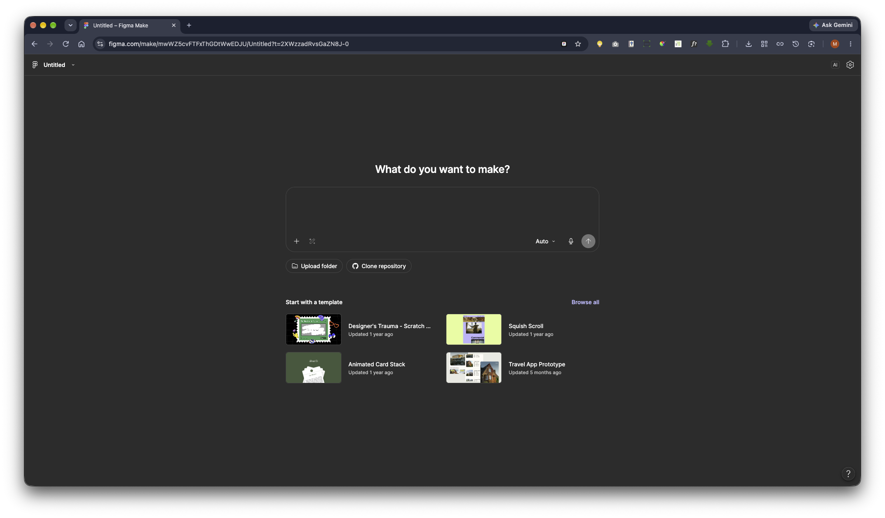
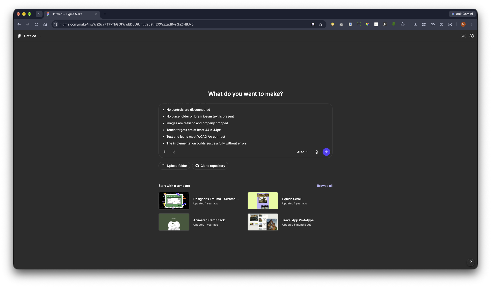
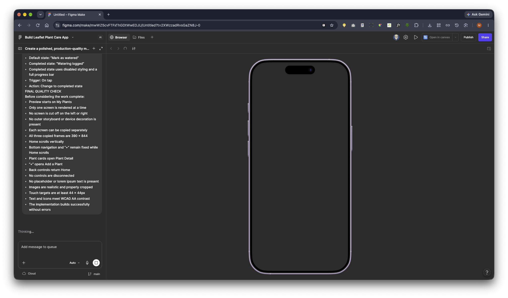
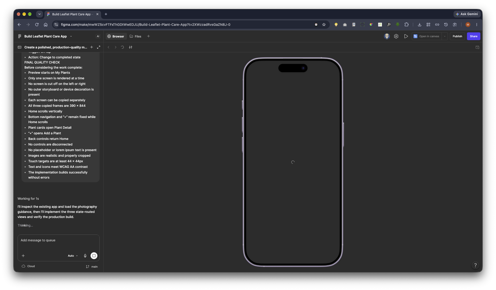
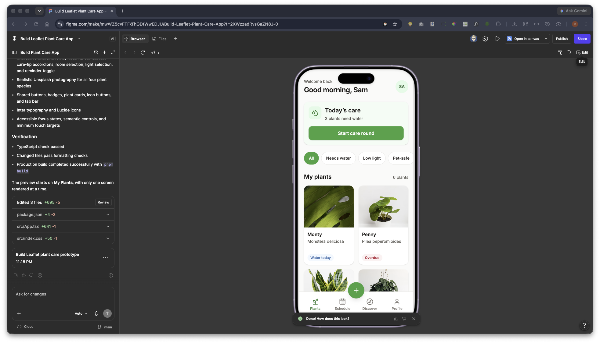
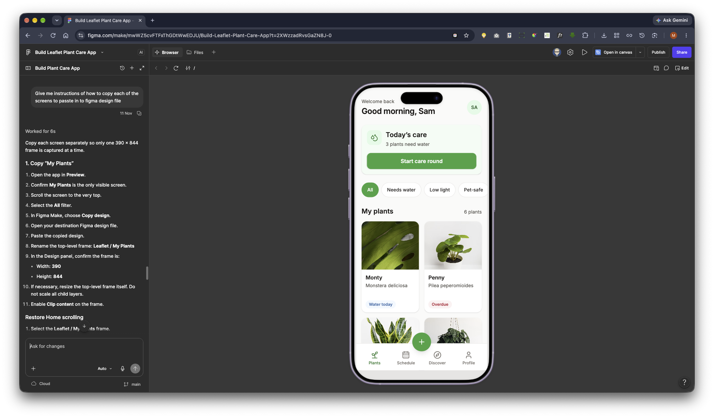
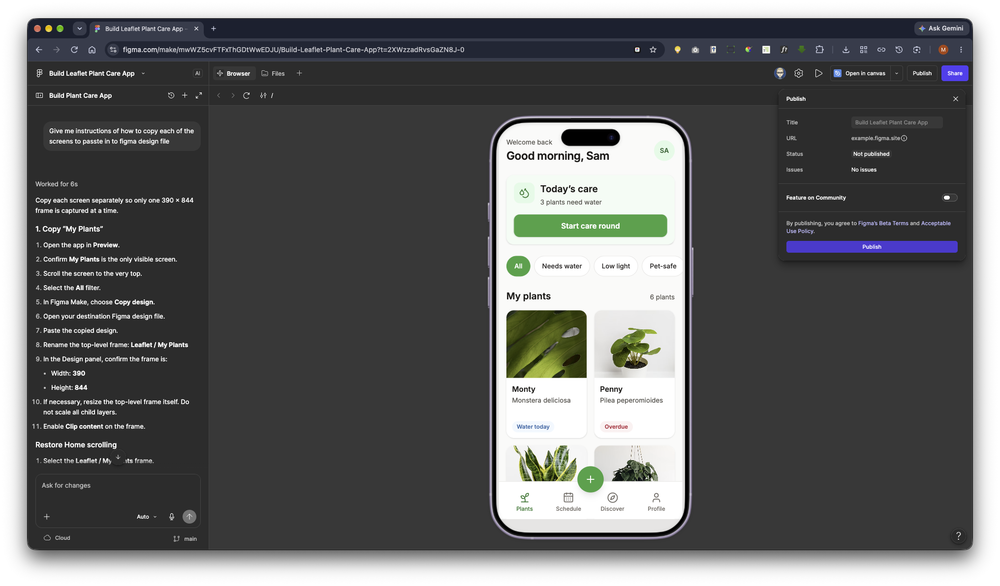
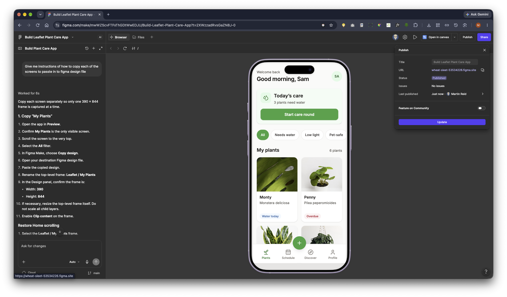
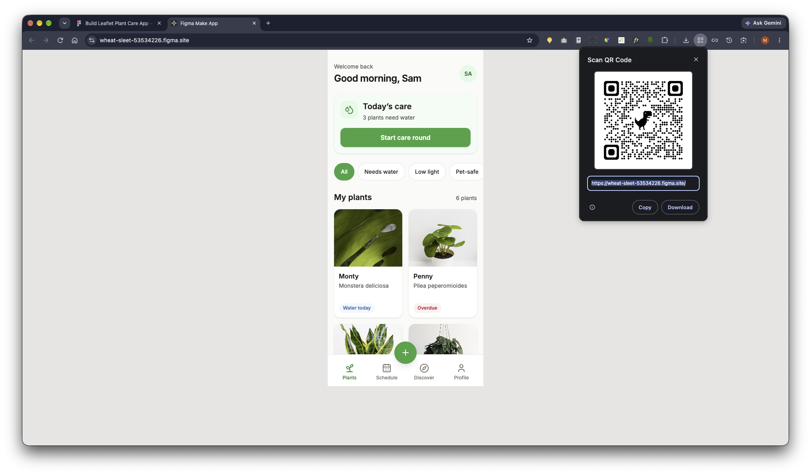
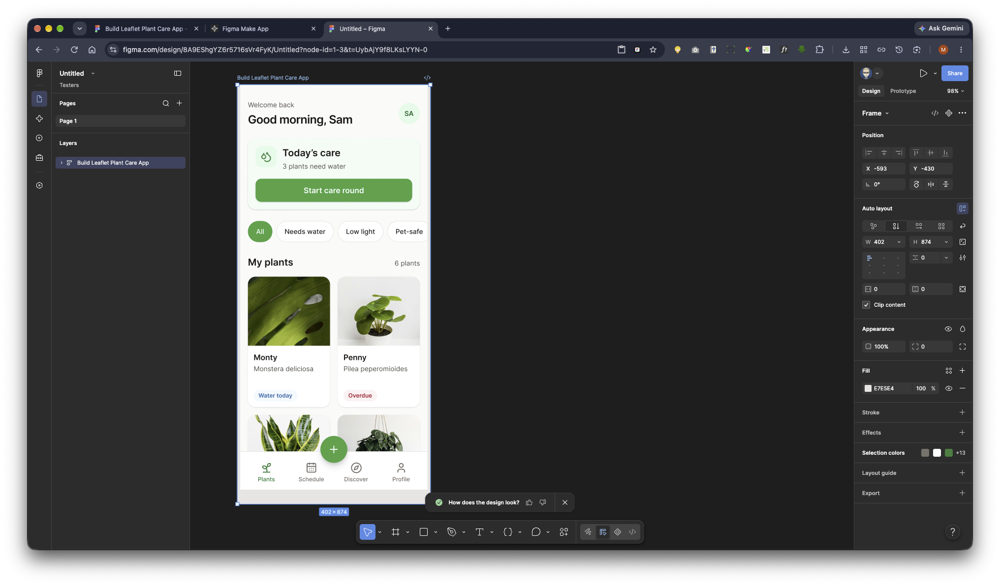
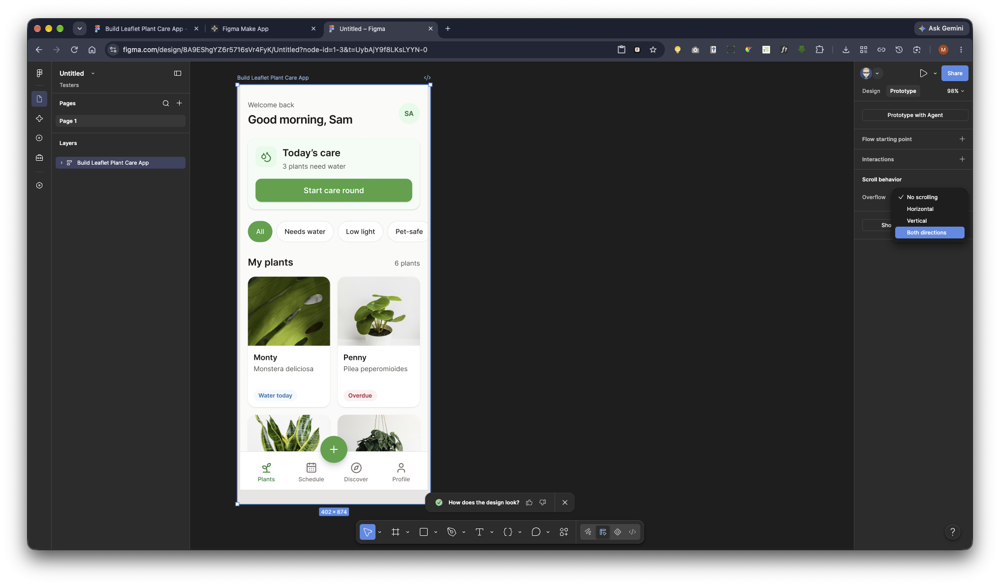
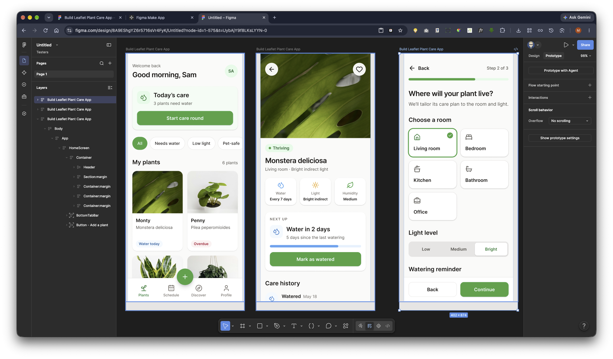
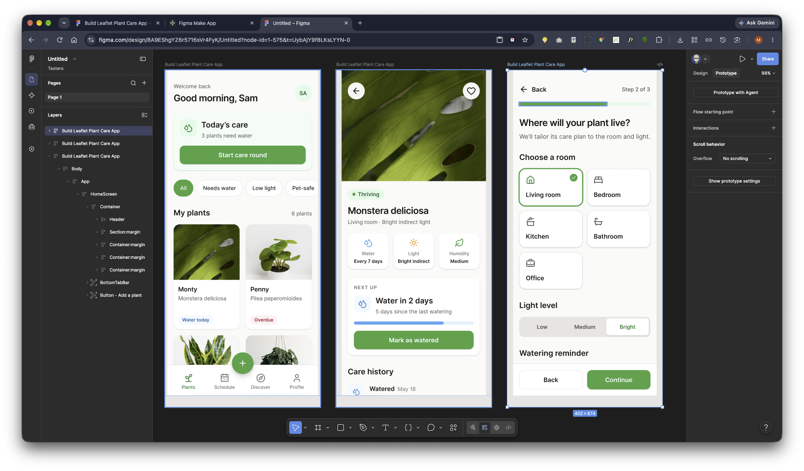

<!--

You are a senior product designer, UX architect, design-system specialist, prototype designer, and prompt engineer.

Your task is to help me create a complete, implementation-ready prompt for any digital product, application, website, feature, workflow, or prototype.

The final prompt you produce may be used with:
- Figma Make
- An AI coding platform
- A design-generation platform
- A website or application builder
- A code-generation assistant
- Another general-purpose AI system

The generated result must be detailed enough to build the requested product with minimal or no follow-up corrections.

WORK IN TWO PHASES

PHASE 1 — REQUIREMENTS INTERVIEW

Do not write the final generation prompt immediately.

First, ask me one organized set of questions. Group related questions together and avoid asking questions one at a time.

Ask only questions that materially affect the result. Provide recommended defaults when I am uncertain.

Ask about the following:

1. PRODUCT

- What is the product, application, website, or feature?
- What is its working name?
- What is its primary goal?
- What problem does it solve?
- Who are its primary users?
- What should users be able to accomplish?
- Is this a new product, a redesign, or a feature added to an existing product?

2. OUTPUT TYPE

- Do I need visual designs, working code, or both?
- Which AI platform will receive the final prompt?
- What framework or technology should be used, if any?
- Should the output use a specific design system?
- Does the result need to be copied into a Figma design file?
- Should screens be presented individually or together?
- Is this a functional prototype or a static design?

3. DEVICE AND RESPONSIVENESS

- Is the product mobile, tablet, desktop, responsive, or multi-platform?
- What exact canvas or viewport dimensions are required?
- Which device should be designed first?
- Are additional breakpoints required?
- Should content scroll inside a fixed device frame?
- Are there fixed headers, navigation bars, action bars, or floating controls?

If I do not provide dimensions, recommend an appropriate standard:
- Mobile: 390 × 844
- Tablet: 768 × 1024
- Desktop: 1440 × 1024

4. INFORMATION ARCHITECTURE

- Which screens, pages, routes, overlays, dialogs, and states are required?
- Which screen should appear first?
- How does the user move between screens?
- Which navigation pattern should be used?
- Are there onboarding, authentication, checkout, search, settings, or account flows?
- Are empty, loading, success, error, disabled, and validation states needed?

5. FEATURES AND INTERACTIONS

For each requested feature, ask:
- What initiates it?
- What changes after the interaction?
- Does it open a new screen, modal, drawer, dropdown, or inline state?
- Does it require form validation?
- Does it require persisted data?
- Does it require authentication, APIs, payments, uploads, notifications, or a backend?
- What should happen after success or failure?

6. CONTENT

- What real content should appear?
- Are there required names, labels, products, records, dates, prices, locations, or messages?
- Should realistic sample content be created?
- Are photography, illustrations, charts, maps, or avatars needed?
- Is there existing content, branding, or imagery to preserve?
- Are there prohibited words, images, claims, or content types?

Do not use lorem ipsum unless I explicitly request it.

7. VISUAL DIRECTION

- What style should the interface communicate?
- Are there reference products, brands, or visual examples?
- What colors are required?
- What font should be used?
- What component shapes, shadows, borders, spacing, and icon styles are preferred?
- Should dark mode be included?
- Are there accessibility requirements beyond WCAG AA?

If I do not specify a visual direction, recommend:
- A restrained, modern interface
- Clear hierarchy
- Generous but efficient spacing
- Neutral page backgrounds
- White content surfaces
- One accessible accent color
- Consistent radii and shadows
- A widely available UI font
- A consistent icon library

8. DESIGN SYSTEM

Ask whether I want:
- Tailwind CSS
- Material Design
- Apple Human Interface Guidelines
- Fluent
- Bootstrap
- An existing company design system
- A custom token system

If Tailwind is selected:
- Use utility classes
- Prefer the default Tailwind scale
- Define specific semantic color roles
- Avoid arbitrary values except for explicitly required viewport dimensions
- Use shared components rather than repeating styles

9. FIGMA COPY AND PROTOTYPE REQUIREMENTS

If the result must be copied into Figma, ask:
- Should each screen be copied individually?
- Should inactive screens be removed from the DOM or merely hidden?
- Should the final prompt include instructions for restoring Figma prototype links?
- Should it include instructions for fixed-position elements and overflow scrolling?
- Should it include interactive component variant instructions?
- Should it include naming conventions for pasted frames and layers?

Recommended default:
- Show one screen at a time
- Render only the active screen
- Do not position inactive screens off-canvas
- Use a distinct route or application state for each screen
- Copy each screen in a separate operation
- Restore connections in Figma after all screens are pasted

10. COMPLETION CRITERIA

Ask:
- What would make the result successful?
- Which requirements are mandatory?
- Which requirements are optional?
- Are there testing, build, accessibility, or performance requirements?

AFTER I ANSWER

Review my answers for contradictions or missing decisions.

If an essential decision is still missing, ask one short follow-up set of questions.

If the brief is sufficiently complete, proceed to Phase 2 without asking for confirmation.

PHASE 2 — GENERATE THE FINAL APPLICATION PROMPT

Produce one self-contained prompt that I can copy directly into the target AI platform.

Do not merely summarize my answers. Convert them into precise implementation instructions.

The final prompt must use the following structure.

1. ROLE AND OBJECTIVE

Define the receiving AI’s role, such as:
- Product designer
- UX designer
- Frontend engineer
- Design-system specialist
- Accessibility specialist
- Prototype designer

State:
- What is being created
- Who it is for
- What outcome it must achieve
- Whether visual design, working code, or both are required

2. NON-NEGOTIABLE OUTPUT RULES

Specify:
- Required screens and states
- Initial screen
- Whether one or multiple screens may be visible
- Whether inactive screens may remain rendered
- Required canvas dimensions
- Whether outer decoration is prohibited
- Whether horizontal overflow is prohibited
- Whether the result must be ready for Figma copying

When screens must be copied individually, require:
- Only one product screen visible at a time
- Active screen replaces the current view
- Inactive screens are not rendered
- No side-by-side storyboard
- No decorative device mockup
- No labels or controls outside the application canvas
- No outer margins on the target device viewport

3. PLATFORM AND TECHNOLOGY

State:
- Target AI platform
- Framework
- Language
- Styling system
- Component library
- Icon library
- Font strategy
- Image strategy
- Routing or state-management requirements
- Backend requirements, if applicable

If no technology was requested, keep the instructions platform-neutral.

4. DEVICE AND CANVAS

Define:
- Exact viewport dimensions
- Responsive behavior
- Maximum width
- Height behavior
- Safe areas
- Internal scrolling
- Horizontal overflow rules
- Fixed or sticky elements
- How the canvas behaves in wider browser previews

For a 390 × 844 mobile screen, specify:
- Width: 100%
- Maximum width: 390px
- Height: 844px or the target preview height
- No body padding on the mobile viewport
- Center only in wider browser windows
- Prevent horizontal scrolling
- Keep scrolling inside the product frame

5. DESIGN SYSTEM AND TOKENS

Define concrete values or system roles for:
- Primary color
- Secondary color
- Neutral colors
- Semantic status colors
- Typography
- Spacing
- Radius
- Borders
- Shadows
- Icons
- Motion
- Touch targets
- Focus styles
- Contrast

Use semantic roles, not vague language.

For example:
- Page background
- Card background
- Primary text
- Secondary text
- Border
- Primary action
- Destructive action
- Success
- Warning
- Information

6. SHARED COMPONENTS

List reusable components, such as:
- PrimaryButton
- SecondaryButton
- IconButton
- TextField
- Select
- Checkbox
- Toggle
- Tabs
- SegmentedControl
- Card
- Badge
- Avatar
- Header
- BottomNavigation
- Modal
- Toast
- EmptyState

For each important component, define:
- Default state
- Hover state
- Pressed state
- Focus state
- Selected state
- Disabled state
- Loading state
- Error state, when relevant

7. SCREEN-BY-SCREEN SPECIFICATION

Create a separate section for every screen.

For each screen include:
- Screen name
- Purpose
- Entry point
- Page structure from top to bottom
- Exact content and copy
- Components
- Images
- Primary action
- Secondary actions
- Navigation
- Scrolling
- Fixed elements
- Empty, error, disabled, loading, and success states
- What changes after every interaction

Avoid vague instructions such as “add relevant content.”

Provide realistic content that matches the product.

8. NAVIGATION MAP

Provide an explicit map, for example:

- Screen A → primary card → Screen B
- Screen A → floating action → Screen C
- Screen B → Back → Screen A
- Screen C → Submit → Screen D
- Screen C → Cancel → Screen A

For each connection define:
- Trigger
- Destination
- Transition
- Back behavior
- Whether state and scroll position are preserved

9. INTERACTION SPECIFICATION

List each interactive element and its behavior.

For each interaction define:
- Initial state
- Trigger
- Immediate visual feedback
- Result
- Error behavior
- Disabled behavior
- Destination, if applicable

Include:
- Forms
- Validation
- Filters
- Toggles
- Accordions
- Tabs
- Menus
- Search
- Selection controls
- Buttons
- Loading states
- Success states
- Error states

10. SCROLLING AND FIXED-POSITION BEHAVIOR

For every screen, specify:
- Whether it scrolls vertically
- Whether any area scrolls horizontally
- Which elements remain fixed
- Which elements scroll
- Required content padding
- Whether scroll position is preserved during navigation
- Whether nested scrolling is allowed

Do not leave scrolling behavior implicit.

11. REALISTIC CONTENT AND ASSETS

Specify:
- Required photography or illustrations
- Image subject
- Aspect ratio
- Cropping behavior
- Alt text
- Avatar content
- Names
- Dates
- Labels
- Prices
- Statuses
- Notifications
- Empty-state language

Prohibit lorem ipsum unless explicitly requested.

12. ACCESSIBILITY

Require:
- WCAG AA contrast
- Minimum 44 × 44px touch targets for touch interfaces
- Visible focus indicators
- Semantic headings
- Form labels
- Error messaging
- Keyboard accessibility
- Appropriate ARIA labels
- Non-color indicators for important states
- Reduced-motion support when applicable
- Meaningful alt text

13. INSTRUCTIONS FOR COPYING EACH SCREEN INTO FIGMA

If Figma copying is required, include a numbered process for every screen.

For each screen specify:
1. How to open it in Preview
2. Which initial state it should be in
3. Where its scroll position should be
4. How to invoke Copy design
5. How to paste it into the destination design file
6. What to name the pasted frame
7. What dimensions to verify
8. What not to scale
9. How to arrange it on the Figma canvas

Require a separate copy operation for each screen.

Do not instruct the user to copy multiple screens at once unless explicitly requested.

14. RESTORING FIGMA PROTOTYPE CONNECTIONS

Explain that copied web interactions may not survive when pasted into a design file.

For each connection specify:
- Source frame
- Source layer
- Trigger
- Action
- Destination frame
- Transition
- Direction
- Duration
- Easing
- Back behavior

Use consistent frame names so the instructions can refer to them exactly.

15. RESTORING FIGMA SCROLLING

For each scrollable frame specify:
- Frame dimensions
- Whether Clip content is enabled
- Overflow behavior
- Which layers belong to scrollable content
- Which layers use Fix position when scrolling
- Required bottom or top content spacing
- Nested horizontal scrolling
- How to prevent the entire frame from scrolling horizontally

16. RESTORING FIGMA INTERACTIVE COMPONENTS

When relevant, include instructions for creating variants for:
- Selected and unselected controls
- On and off toggles
- Open and closed accordions
- Favourite states
- Default, loading, success, and disabled buttons
- Form validation
- Active and inactive tabs
- Filters
- Menus
- Progress states

For each variant define:
- Visual differences
- Trigger
- Change-to action
- Animation
- Starting state

17. IMPLEMENTATION QUALITY

Require:
- Shared components
- No disconnected controls
- No placeholder actions
- No unintended overflow
- No content hidden under fixed navigation
- No duplicate screens in the DOM when individual copying is required
- No unrelated changes
- Successful build
- Appropriate functional testing
- Responsive checks
- Accessibility checks

18. FINAL ACCEPTANCE CHECKLIST

End the generated prompt with a checkbox-style quality checklist that covers:
- Every requested screen
- Every requested interaction
- Canvas dimensions
- Initial route
- Copying behavior
- Scrolling
- Fixed elements
- Navigation
- Content
- Assets
- Accessibility
- Build verification
- Figma reconnection instructions

OUTPUT RULES FOR THIS META-PROMPT

When generating the final application prompt:
- Make it self-contained
- Make it directly copyable
- Do not refer back to our conversation
- Do not omit requirements because they appear obvious
- Do not include unexplained placeholders
- Use my actual product names, screen names, content, and requirements
- Clearly separate requirements from recommendations
- Resolve ambiguities using the defaults I accepted
- Preserve any existing design system I provide
- Do not invent backend functionality unless it is required
- Clearly identify functionality that requires a backend
- Use precise instructions instead of subjective phrases
- Include realistic copy and data
- Include both visual and behavioral requirements
- Include Figma copying and restoration instructions whenever requested

Begin with Phase 1 now.

**This is not part of prompt**

How to use it
Paste the meta-prompt into your chosen AI platform.
Answer its requirements interview.
It will generate the final product-specific prompt.
Paste that generated prompt into Figma Make or your selected builder.
Copy each resulting screen into Figma using the screen-specific instructions it produces.
Restore prototype links, scrolling, and component states using its Figma restoration section.


Copy each screen separately so only one 390 × 844 frame is captured at a time.

1. Copy “My Plants”
Open the app in Preview.
Confirm My Plants is the only visible screen.
Scroll the screen to the very top.
Select the All filter.
In Figma Make, choose Copy design.
Open your destination Figma design file.
Paste the copied design.
Rename the top-level frame: Leaflet / My Plants
In the Design panel, confirm the frame is:
Width: 390
Height: 844
If necessary, resize the top-level frame itself. Do not scale all child layers.
Enable Clip content on the frame.
Restore Home scrolling
Select the Leaflet / My Plants frame.
Open the Prototype panel.
Set Overflow behavior to Vertical scrolling.
Select the bottom tab bar and enable Fix position when scrolling.
Select the floating green + button and enable Fix position when scrolling.
Keep both fixed elements inside the top-level frame.
Confirm the final plant cards can scroll above the navigation.
If the filter chips exceed the available width:

Put them inside a nested clipped frame.
Set that nested frame’s overflow to Horizontal scrolling.
Keep the top-level Home frame vertical-only.
2. Copy “Plant Detail”
Return to the Figma Make Preview.
Tap the Monty / Monstera plant card.
Confirm Plant Detail fully replaces My Plants.
Scroll Plant Detail to the top.
Choose Copy design.
Return to the same Figma design file.
Paste it beside the Home frame, leaving clear canvas spacing.
Rename the frame: Leaflet / Plant Detail
Confirm its dimensions are 390 × 844.
Enable Clip content.
In the Prototype panel, set overflow to Vertical scrolling.
3. Copy “Add a Plant”
Return to Preview.
Use the upper-left back button to return to My Plants.
Tap the floating green + button.
Confirm Add a Plant fully replaces My Plants.
Scroll the screen to the top.
Choose Copy design.
Paste it into the same Figma design file.
Rename the frame: Leaflet / Add a Plant
Confirm its dimensions are 390 × 844.
Enable Clip content.
Set overflow to Vertical scrolling if its content extends below the frame.
Fix the bottom action bar when scrolling if that behavior was not retained.
Reconnect the prototype
Copied web interactions may not remain connected after pasting.

My Plants → Plant Detail
For each plant card on Leaflet / My Plants:

Select the card’s interactive layer.
Drag its prototype connector to Leaflet / Plant Detail.
Configure:
Trigger: On tap
Action: Navigate to
Animation: Smart animate
Duration: approximately 300ms
Easing: Ease out
At minimum, connect the Monty card. Ideally, connect all four cards.

My Plants → Add a Plant
Select the floating green + button.
Connect it to Leaflet / Add a Plant.
Configure:
Trigger: On tap
Action: Navigate to
Animation: Move in
Direction: From right
Duration: approximately 300ms
Easing: Ease out
Plant Detail → My Plants
Select the upper-left back button.
Configure:
Trigger: On tap
Action: Back
Animation: Smart animate, or Move out to the right
Duration: approximately 300ms
Add a Plant → My Plants
Connect all three controls:

Header Back: On tap → Back
Bottom Back: On tap → Back
Continue: On tap → Navigate to → Leaflet / My Plants
Use a subtle Smart animate transition of approximately 300ms.

Optional interactive components
For a higher-fidelity prototype, create component variants for:

Filter chips: default and selected
Favorite button: outline and filled
Reminder toggle: on and off
Room cards: default and selected
Light segments: selected and unselected
Mark as watered card: pending and completed
Use On tap → Change to between variants. Ensure these initial states are selected:

All filter
Favorite off
Reminder on
Living room
Bright
Mark as watered pending
Finally, set Leaflet / My Plants as the prototype’s starting point.

-->