{: .no_toc }

# Figma Basics

### Change Icon on Apple iOS UI Kit

We have used the Apple iPhone Design Kit in Figma and want to replace the existing app icon with our own icon so that it represents the app we have created.

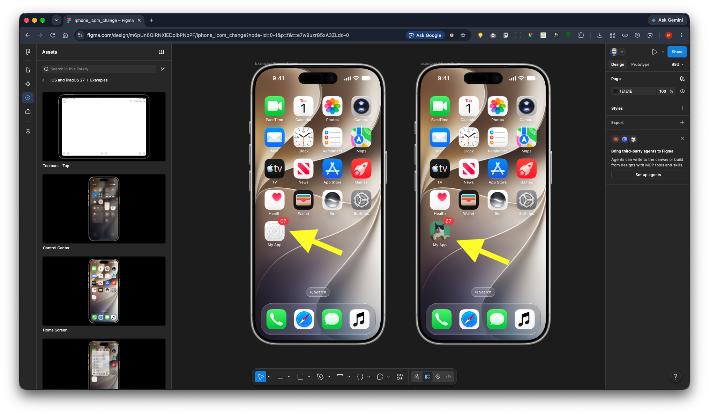

Create a new design file in Figma.

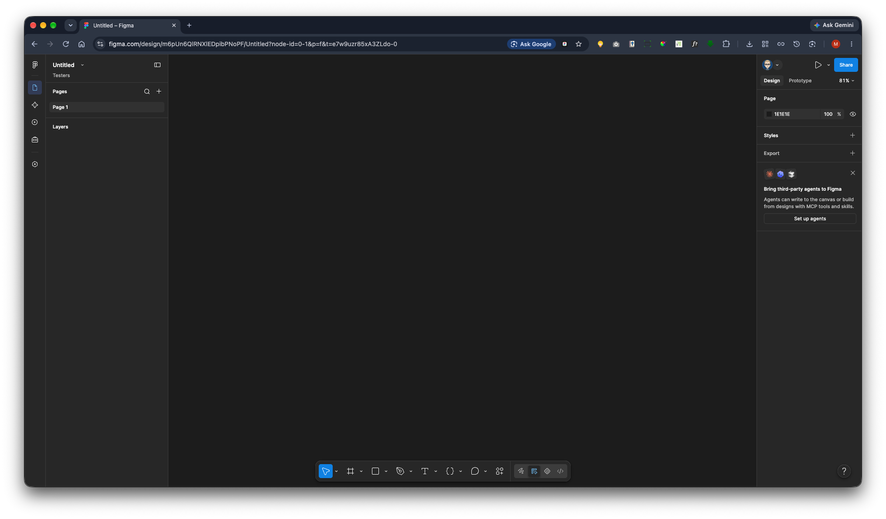

In the left-hand navigation panel, select Assets.

Locate the latest iPhone and iPad UI Kit and click the + icon to add it to your project.

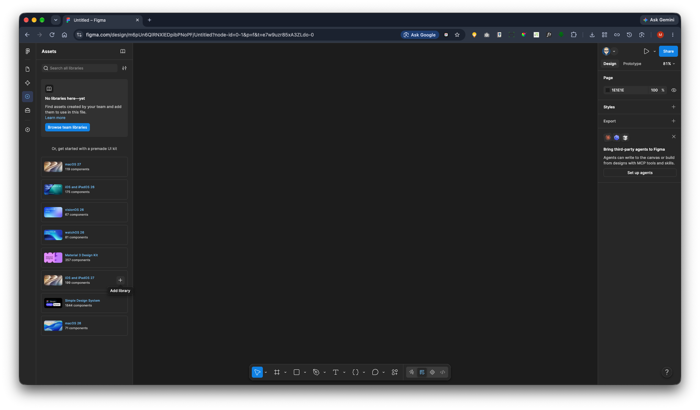

Open the Examples section.

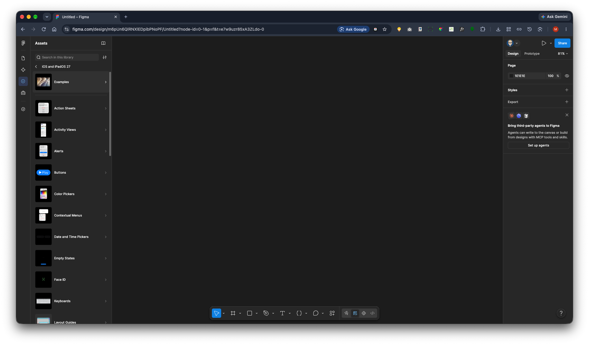

Select iPhone Home Screen and insert it into your design file.

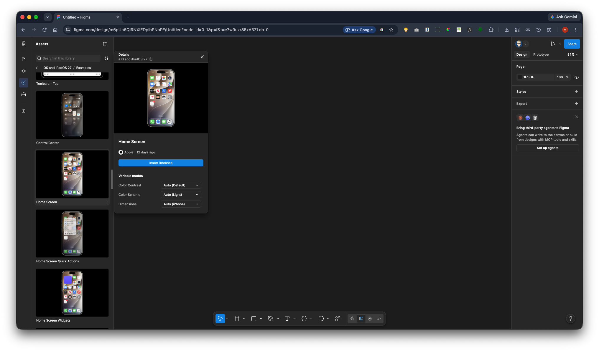

The home screen will appear on your design canvas.

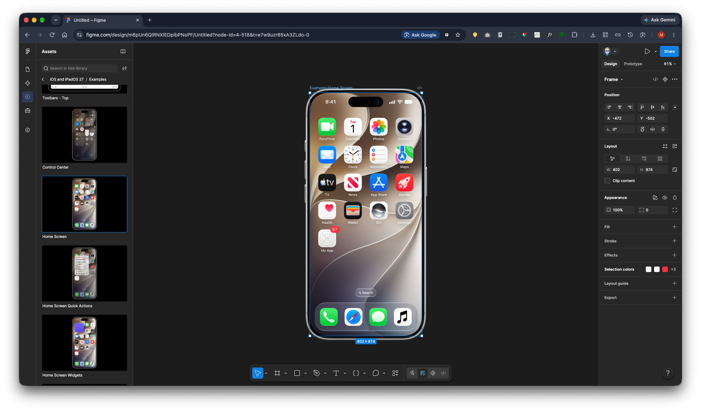

Select the My App icon and zoom in for easier editing.

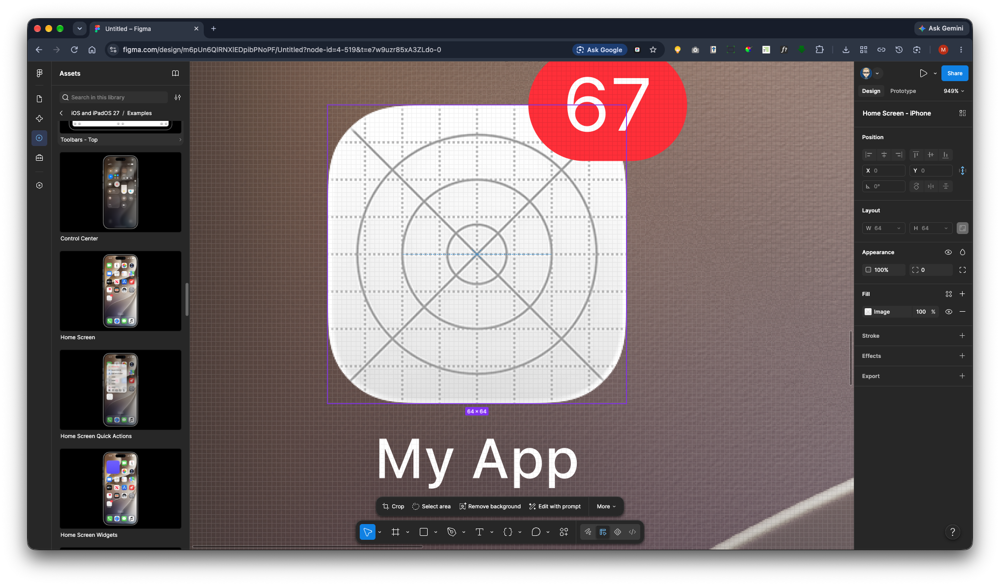

Open the Layers panel (if it isn't already visible) and select the layer named Custom Icon Default.

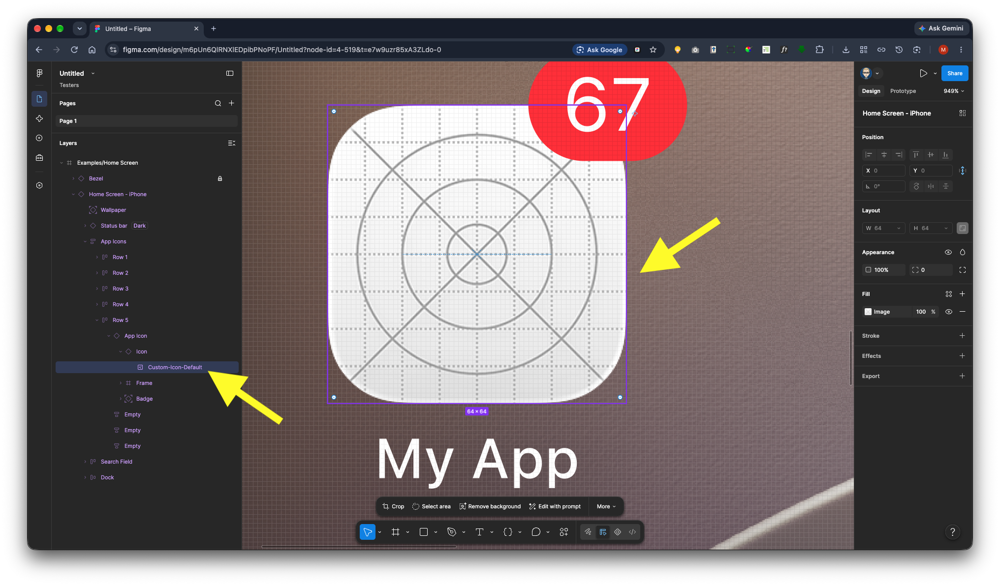

In the properties panel on the right, click Image.

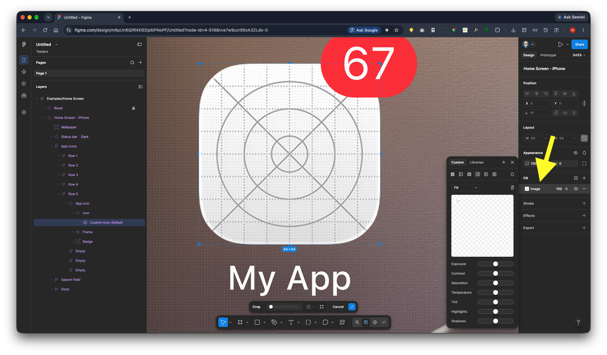

Click the image preview and select Upload from Computer.

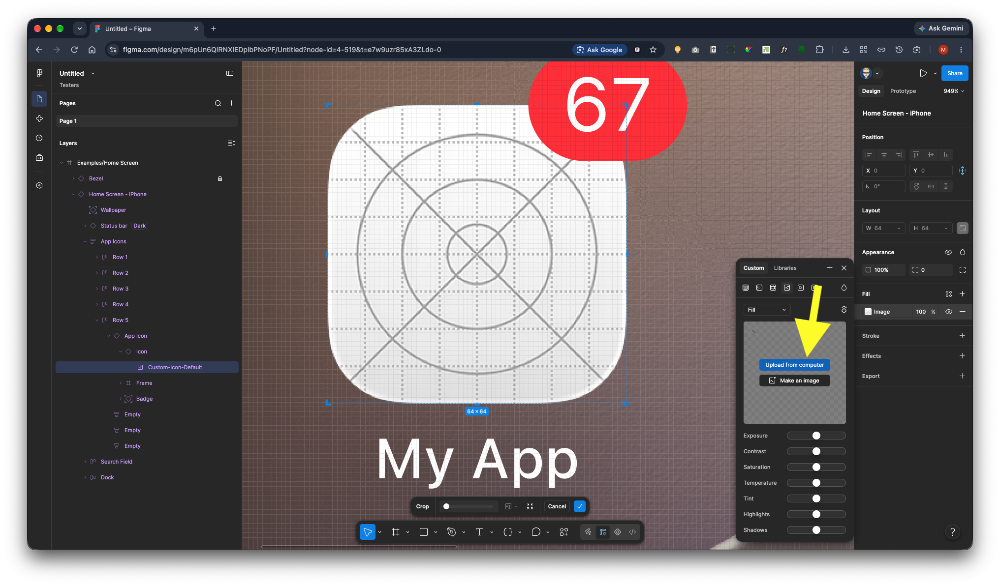

Choose your app icon image.

* The image should have a square aspect ratio.
* A size of 64 × 64 pixels is recommended.
* Figma will automatically fit the image provided the aspect ratio is correct.

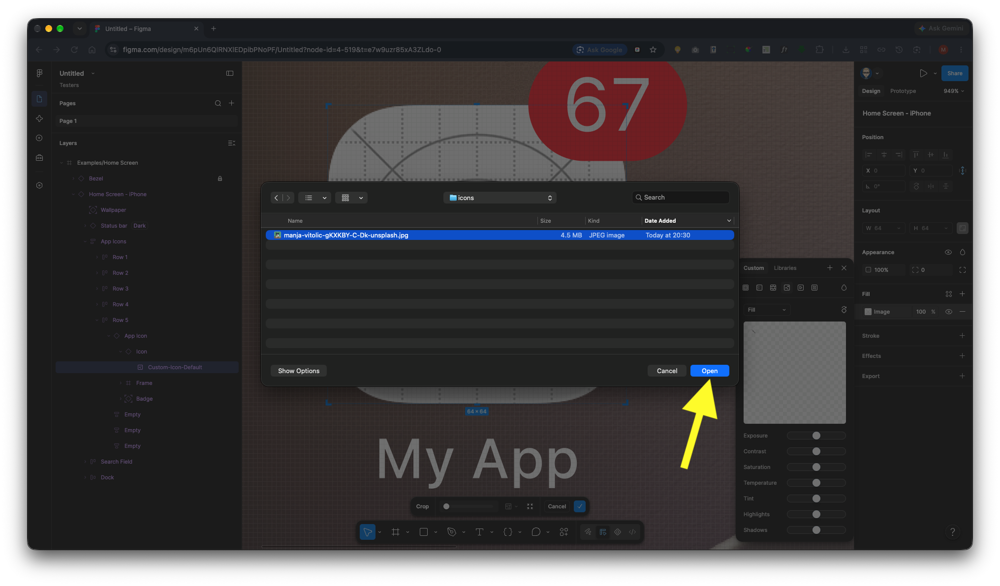

Once uploaded, your image will replace the placeholder icon and appear on the home screen.

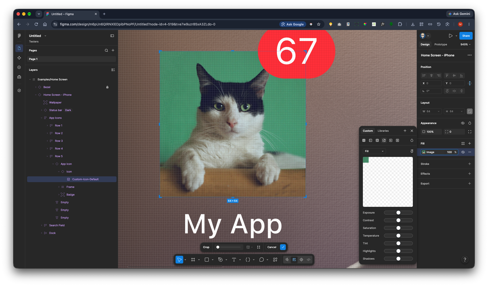

With the icon selected, go to the Properties panel on the right-hand side.

Change the Corner Radius value from 0 to 16. This will match the rounded corners used by the other app icons on the home screen.

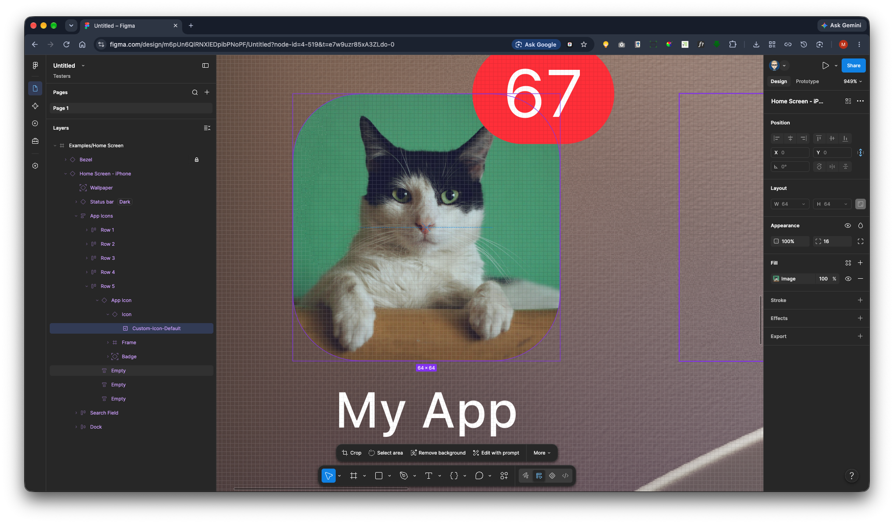

Zoom out to view the completed update and confirm that the new icon is consistent with the rest of the interface.

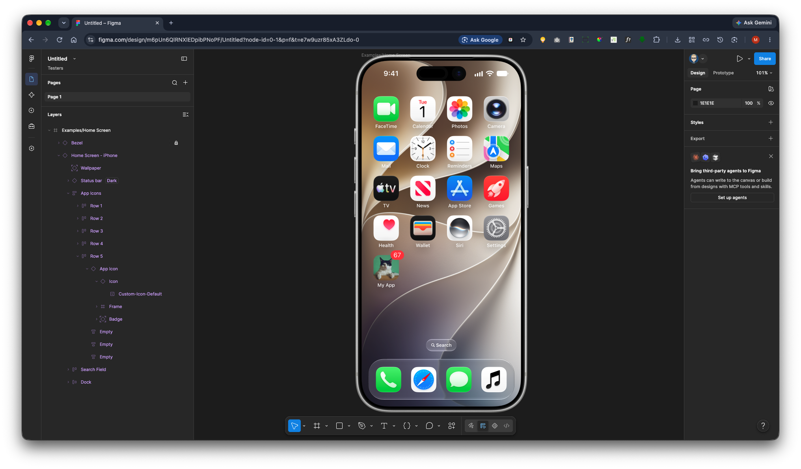