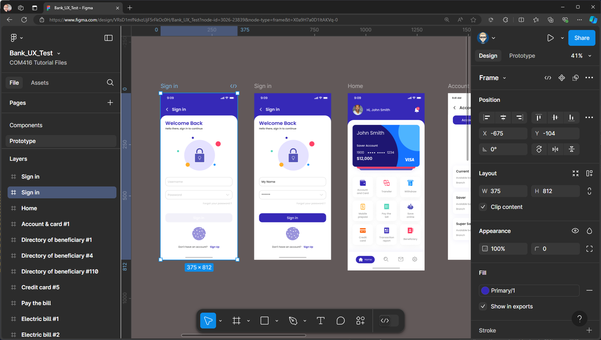
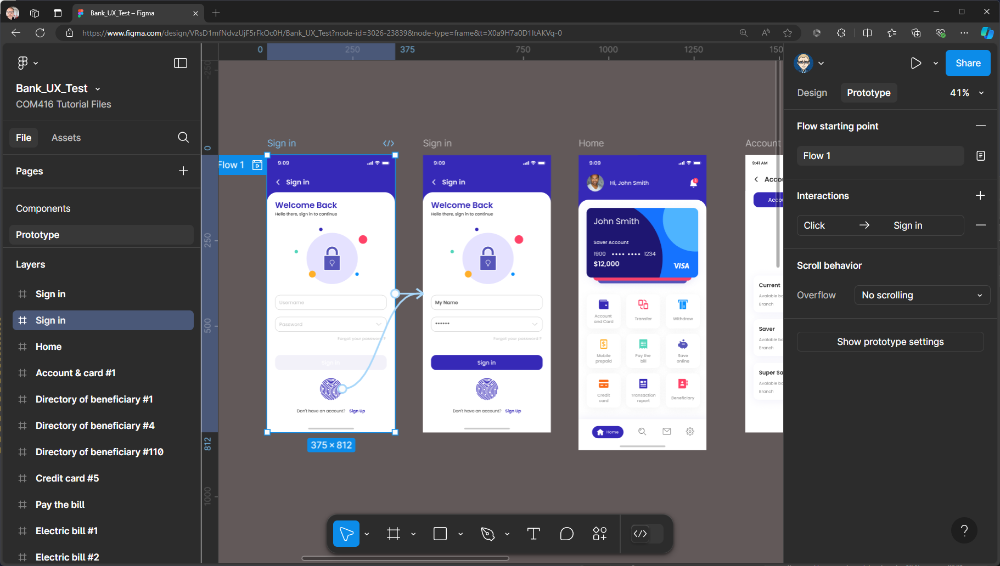
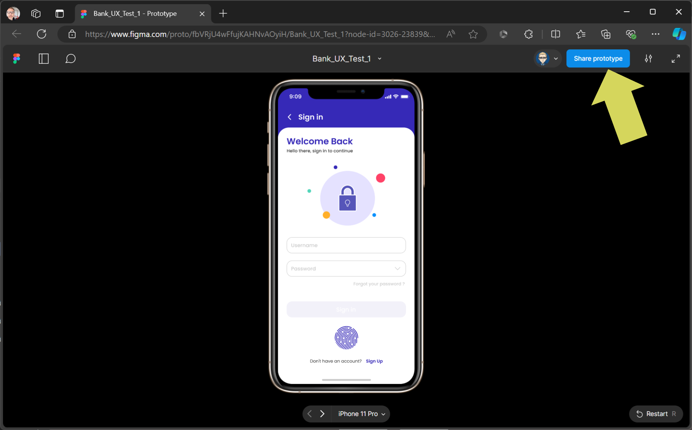
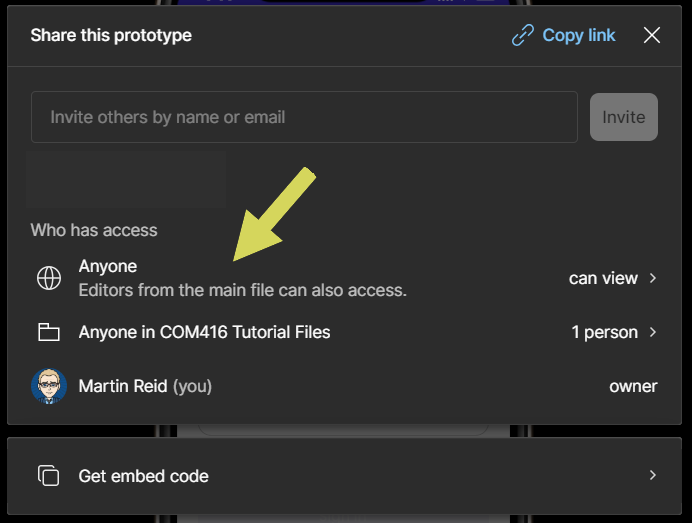
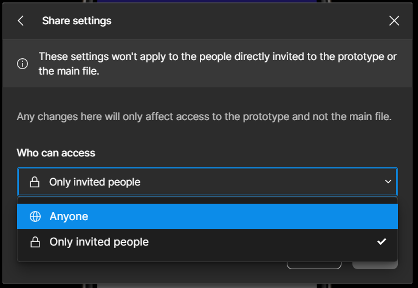
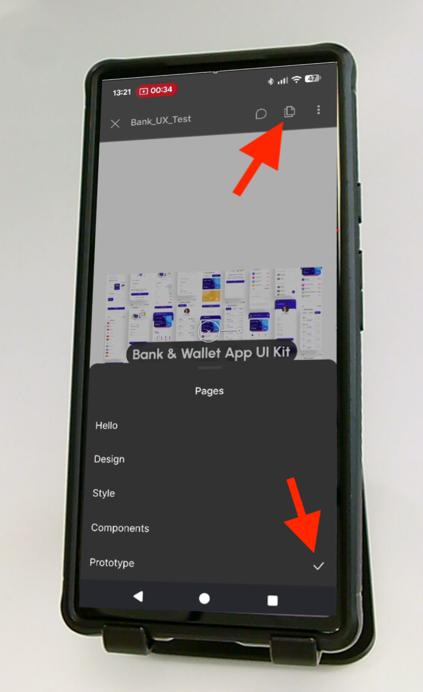
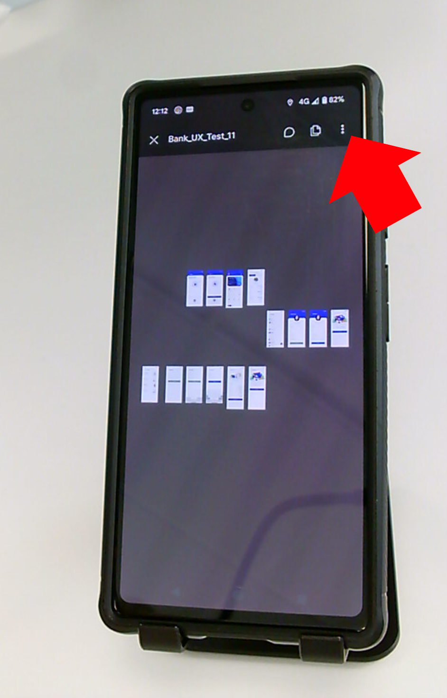
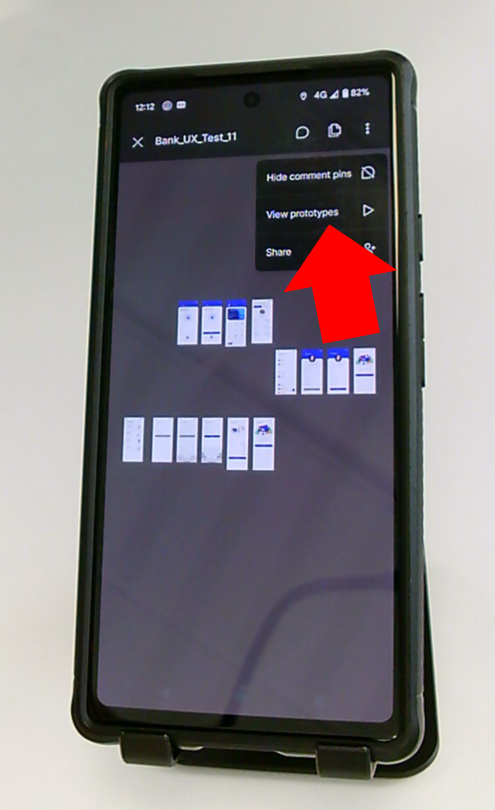
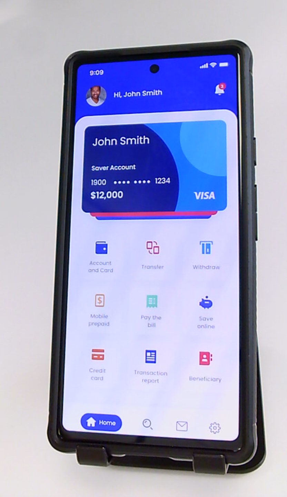
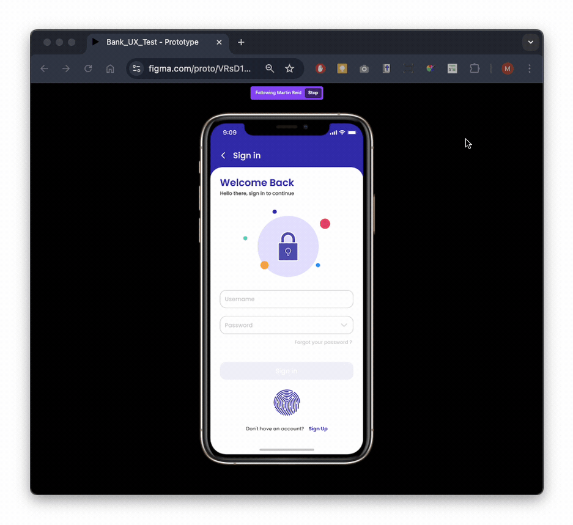

{: .no_toc }

{: .note-title }
> NOTE:
>
> What Figma remains an excellent tool for creating full digital designs, design systems, and polished UI concepts. It is widely used in industry and includes a growing range of AI-assisted features.
>
> However, for those with limited design experience who need to quickly create and test an idea, AI-powered prototyping and vibe-coding tools such as ChatGPT, Claude Code, Google Stitch, and Lovable can often produce more realistic, interactive prototypes with less effort. This makes them particularly useful for validating a concept, exploring usability, and testing whether a product has a genuine user need before investing significant time in detailed UI design.
>
> The focus when undertaking a user experience project effective UX research, testing, and design decision-making rather than mastery of a single tool. While Figma remains an important part of the learning experience, it is best to explore AI-supported alternatives and select the approach that best supports rapid prototyping and user testing.

# Testing on a device
You have made your Prototype and it time to share and use it in a UX testing session.

### Part 1 - (Steps 1-5) Share Your Prototype

Select the first frame, switch to the Prototype tab, click Share prototype, invite people by email, choose Invite only or Anyone

	<iframe src="https://solent.cloud.panopto.eu/Panopto/Pages/Embed.aspx?id=5d7310b0-26e6-452a-a549-b50a0153eaaf&autoplay=false&offerviewer=true&showtitle=true&showbrand=true&captions=true&interactivity=all" style="border: 1px solid #464646; position: absolute; top: 0; left: 0; width: 100%; height: 100%; box-sizing: border-box;" allowfullscreen allow="autoplay" aria-label="Panopto Embedded Video Player" aria-description="Part 1 - (Steps 1-5) Share Your Prototype"></iframe>

 
1. Select the first screen (Frame) of your Prototype

2. Change the Design view to Prototype

3. Click on Share Prototype button

4. You can email an invite to people or you can have it accessible to everyone - you can click to change

5. Invite Only or Anyone

### Part 2 (Steps 6-8) - Open on test device

On the phone: open the file, tap the three dots, choose View prototype

	<iframe src="https://solent.cloud.panopto.eu/Panopto/Pages/Embed.aspx?id=0e973324-c549-4702-a087-b50a0153d6d7&autoplay=false&offerviewer=true&showtitle=true&showbrand=true&captions=true&interactivity=all" style="border: 1px solid #464646; position: absolute; top: 0; left: 0; width: 100%; height: 100%; box-sizing: border-box;" allowfullscreen allow="autoplay" aria-label="Panopto Embedded Video Player" aria-description="Part 2 (Steps 6-8) - Open-on-test-device"></iframe>

 
6. On the test device change to the page that has your prototype

7. On the test device click on 3 dots top right

Then click view prototype

There are issues with Figma wanting a person who has been sent a link, but does not have Figma account and Figma app opening the Prototype [more details here](https://forum.figma.com/t/sharing-a-prototype-without-having-user-required-to-sign-in-to-figma/40423)

or if they can open it without a Figma account and the Figma app it will not present full screen.

To get round this this they would have to sign up for a Free Figma account, then download the app to open the prototype link which might be a hassle to them or you could use a test who you know has a Figma account and app, **or if doing in-person testing you can use the app set up on your device, which might be the best solution**

**Note:** This only applies to tests on phones or tablets - if UX testing a website, this will not be an issues as it will work in the browser without a log in.

8. The prototype will now open up on the test device.

### Part 3 - (Steps 9-12) Watch from your computer 

The two avatars in the top bar and what each version means, selecting the tester, Multiplayer tools and Click to follow, then the tester's taps showing up on your computer, ending with a reminder to start a screen recording

	<iframe src="https://solent.cloud.panopto.eu/Panopto/Pages/Embed.aspx?id=851371bd-2237-4473-9ae1-b50a0153cd9f&autoplay=false&offerviewer=true&showtitle=true&showbrand=true&captions=true&interactivity=all" style="border: 1px solid #464646; position: absolute; top: 0; left: 0; width: 100%; height: 100%; box-sizing: border-box;" allowfullscreen allow="autoplay" aria-label="Panopto Embedded Video Player" aria-description="Part 3 - (Steps 9-12) Watch-from-your-computer"></iframe>

 
9. Check the prototype on your computer. You'll see two users displayed in the top bar. If the tester is logged in using your Figma app, there will be two instances of your avatar. Otherwise, you'll see either their Figma avatar or an anonymous user icon.

10. In any case you need to select the user logged in on the test device 

The computer login will show **Multi-Player Tools**, the test device will have **Click to Follow** Click to follow

11. Now when the tester interacts with the prototype on the test device their interactions will be reproduce in the Figma prototype on the computer., so the screen can be recorded for later analyst.

### Part 4 - Known issues & workarounds

The two known issues, the three workarounds (the best solution is marked), the forum reference and the note that this only applies to phones and tablets
 

	<iframe src="https://solent.cloud.panopto.eu/Panopto/Pages/Embed.aspx?id=51ea9aac-a94c-4267-a196-b50a0153c7c7&autoplay=false&offerviewer=true&showtitle=true&showbrand=true&captions=true&interactivity=all" style="border: 1px solid #464646; position: absolute; top: 0; left: 0; width: 100%; height: 100%; box-sizing: border-box;" allowfullscreen allow="autoplay" aria-label="Panopto Embedded Video Player" aria-description="Part 4 - Known issues &amp; workarounds"></iframe>

