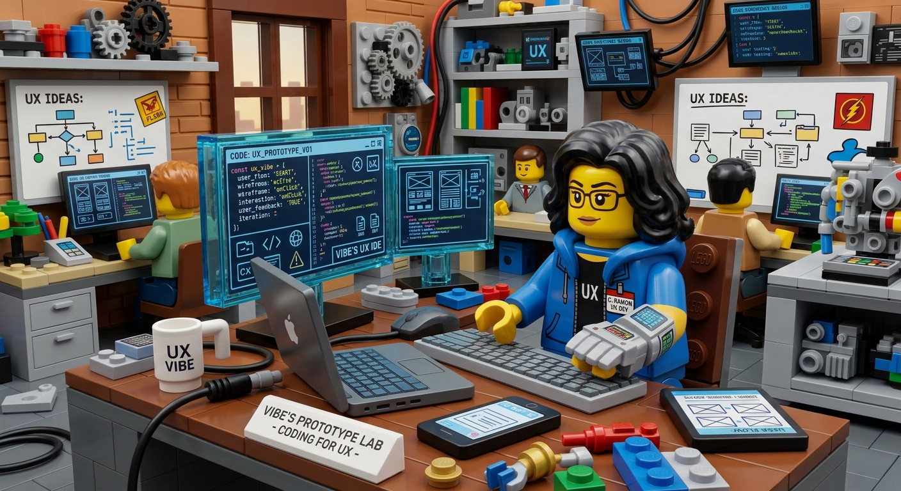
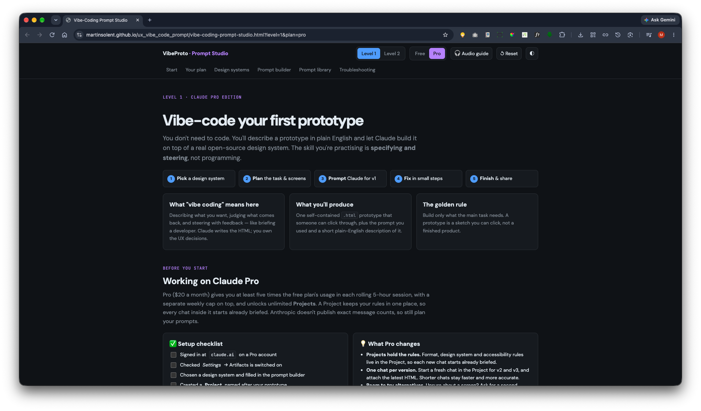
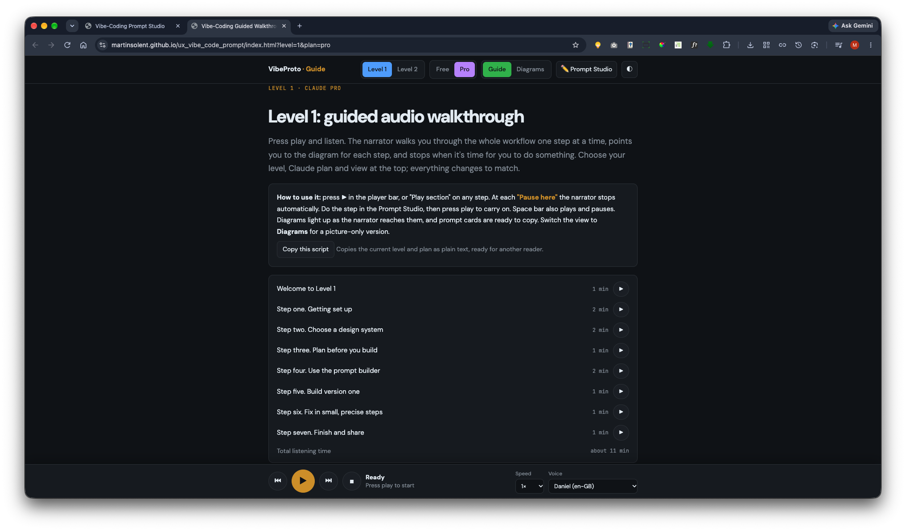

# Prompting to Vibe-Code Testable UX Prototypes: An Overview for Non-Coders



## What vibe-coding a prototype means

You can now describe an app in plain English and get back a working, clickable prototype that real people can test on their own phones. You write no code yourself. The skill moves from typing code to writing precise instructions, which we call prompting.

"Vibe coding" is the informal name for this way of working. You describe the *intent* (what the app is for, who uses it, how it should behave), an AI tool such as Claude writes the HTML, CSS and JavaScript, and you review the result in the browser and ask for changes in conversation. A typical first version takes minutes, and each change takes seconds.

This matters for UX testing because the thing you put in front of participants behaves like a real product: buttons respond, forms validate, menus open, content changes. Test participants react to what it does, not to a picture of what it might do.

## Why this can go further than a Figma prototype

A Figma prototype is a set of drawn screens joined by hotspots. It simulates behaviour: you decide in advance which taps lead where, and anything off that path simply does nothing. A coded prototype *runs*. It holds state, accepts whatever a participant types, reacts to the screen size, and can be opened from a link with no account or app.

Figma is still excellent for exploring visual ideas quickly and for sharing design intent with a team. The point is not that it is bad, but that for usability testing the gap between "looks right" and "works" matters, and prompting closes it without needing a developer.

|  | Linked-screen prototype (typical Figma) | Prompted, coded prototype |
| --- | --- | --- |
| What participants experience | A guided path through pre-drawn screens | A working app that responds to whatever they do |
| Forms and input | Fixed placeholder text | Real typing, validation, error messages |
| Logic and state | Limited; each variation is another screen | Built in: filters, baskets, logins, search, progress |
| Responsive behaviour | Separate frames per device | One page that adapts to any screen |
| Accessibility | Annotated or approximated | Real keyboard use, focus order and screen-reader semantics can be tested |
| Sharing for a test | Viewer link, often needs the Figma app or account | Plain web link, opens in any browser |
| Changing it between sessions | Redraw frames and re-wire links | Ask for the change in one sentence |
| Hosting | Figma's servers | Your own: GitHub Pages is free and permanent |

Hosting is a real advantage. A prototype is just a small set of front-end files (HTML, CSS and JavaScript), so it can live on GitHub Pages, GitHub's free static website hosting. You own the files, you can version them, and a participant opens a normal web address.

## What you need to know to prompt well

The AI writes the code, but it cannot decide what good looks like. The quality of a prototype is set by how well your prompt carries five kinds of design knowledge. If you leave one out, the tool fills the gap with generic defaults, and generic defaults are where usability and accessibility problems come from.

| Knowledge area | What it means | What to put in the prompt |
| --- | --- | --- |
| Design system | A shared set of rules and components: colours, type scale, spacing, buttons, forms, patterns | Name an open-source system (for example GOV.UK Design System, Material Design, Bootstrap or USWDS) and say "use its components, spacing and typography; do not invent new ones" |
| Interaction design | How the interface responds: states, feedback, transitions, navigation | List each state a control needs (default, hover, focus, disabled, error, loading, success) and what the user sees after each action |
| Usability | Whether real people can complete real tasks easily | Describe the user, their task and the steps; ask for clear labels, visible progress, confirmation before destructive actions and helpful error messages; apply Nielsen's ten heuristics |
| Accessibility | Whether people with different abilities and devices can use it | Require WCAG 2.2 level AA: text contrast of at least 4.5:1, full keyboard operation, visible focus, labels on every field, alt text, no information by colour alone, touch targets large enough |
| Systems design | How the parts connect: screens, data, rules, user roles, flows | Describe the whole system first: who the users are, what data exists, what rules apply, and how one screen leads to the next, before asking for any single screen |

A useful rule: **if you can name it, you can ask for it.** Someone who can say "a modal dialog that traps focus and returns it to the button that opened it" gets that behaviour. Someone who says "a popup" gets whatever the tool guesses. The vocabulary of UX design is therefore the vocabulary of effective prompting.

Two of these deserve special attention. Systems design comes first because a prototype built screen by screen, with no model of the whole, drifts: names change, rules contradict each other and the flow breaks. Accessibility comes second because it is far cheaper to ask for it in the first prompt than to retrofit it, and standards such as WCAG are something you must specify, not something the tool applies unprompted.

## Anatomy of a good prompt

A strong prompt works like a brief to a designer-developer. It says who the product is for, what they need to do, which rules to follow and what "done" looks like. The example below, for a library study-room booking app, uses six parts: purpose, users, system, design system, behaviour and standards.

```markdown
**Purpose.** Build a clickable prototype of a study-room booking app for
undergraduate students, to test whether first-year students can book a
room in under a minute.

**Users.** First-year students on phones, often in a hurry, some using
screen magnification, some navigating by keyboard.

**System.** Three screens: (1) room search with filters for date, time
and group size; (2) results list; (3) booking confirmation. Use made-up
but realistic data for 8 rooms. A student can hold only one booking at
a time. A booking can be cancelled from the confirmation screen.

**Design system.** Use the GOV.UK Design System components, spacing and
type scale. Do not invent new component styles.

**Behaviour.** Every button, input and link has default, hover, focus,
disabled and error states. Show a clear message if no rooms match.
Ask for confirmation before cancelling. Show where the user is in the
three-step process.

**Standards.** Meet WCAG 2.2 AA: 4.5:1 text contrast, everything usable
by keyboard alone, visible focus, a label for every field, errors that
name the problem and how to fix it, touch targets at least 44 by 44
pixels. Use semantic HTML.

**Output.** One self-contained HTML file with inline CSS and JavaScript,
no build steps, that I can upload to GitHub Pages.
```

Notice what the prompt does not do. It never mentions code. Every sentence is a design decision, and every decision is one a UX student can learn to make.

**Iterate in small steps.** After the first version, ask for one change at a time ("the focus outline is hard to see on the blue button; make it a 3 pixel dark outline"). Short, targeted corrections keep the prototype stable. Asking the tool to rebuild everything each time often breaks things that already worked.

## From prompt to a testable link


The work runs in short cycles. You describe the system and write the prompt, review what comes back and ask for single changes until it behaves, then check it against the standards, publish it and test it with people. What you learn from participants goes straight into the next brief.

Publishing is the least technical step. The finished prototype is one HTML file. Create a free GitHub account and a new repository, upload the file, and switch on GitHub Pages in the repository settings. GitHub then gives you a permanent web address to send to participants. Because the file is plain front-end code, there is no server to run and nothing to install.

## Honest limits

Asking for a standard does not guarantee you meet it. A prompted prototype is a strong, testable draft; it is not a certified product. Three habits keep the claims honest.

- **Verify, don't assume.** Run an automated checker (such as the WAVE browser extension or Lighthouse in Chrome) and then test by hand: tab through every control, zoom to 200 percent, and try a screen reader. Automated tools catch only part of WCAG; the rest needs a person.
- **Prototype data is not real data.** Prompted prototypes use invented content and run in the browser only. Do not collect real personal data in one, and say so to participants.
- **You are still the designer.** The tool will happily build a confusing flow if you describe one. The judgement about what to test, what the task is and whether the result is usable stays with you, and the vocabulary in this overview is how you exercise it.

Next steps for a first attempt: pick one small task, pick one open-source design system, write the six-part prompt above, and test the result with two or three people before changing anything.


## VibeProto · Prompt Studio App

VibeProto teaches UX students to build clickable prototypes with Claude without writing code. You describe the prototype in plain English. Claude builds it on top of a real open-source design system. You judge the result and steer it with small, precise changes.

The skill you practise is specifying and steering, not programming. Claude writes the HTML, and you make the UX decisions.

Live site: [https://martinsolent.github.io/ux_vibe_code_prompt/](https://martinsolent.github.io/ux_vibe_code_prompt/)




