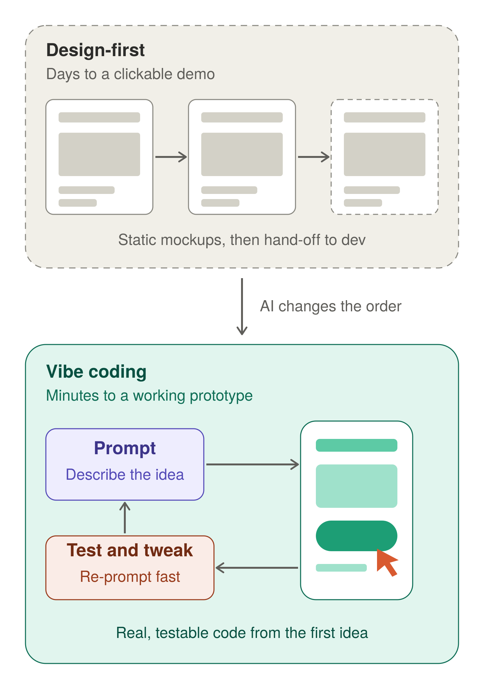

{: .no_toc }

# Vibe Coding

Vibe coding is the practice of using AI to turn plain-English ideas into working software or prototypes, without needing to write much code yourself. The term was coined by AI researcher [Andrej Karpathy](https://www.youtube.com/watch?v=96jN2OCOfLs) in 2025 and reflects a growing shift towards describing what you want rather than programming every detail yourself.

For UX students, vibe coding is not a replacement for design skills. Instead, it helps you quickly turn ideas into interactive prototypes that can be tested with users. You still need to understand user-centred design, usability, stakeholder needs, accessibility, and design systems to ensure what you build solves a genuine problem and provides a good user experience. AI can create the prototype, but it cannot decide whether the product is useful, usable, or valuable.

Vibe coding lets you rapidly create and test digital product ideas, while UX knowledge ensures those ideas are worth building in the first place.

**Some of the most popular platforms and tools for vibe coding are:**

- [ChatGPT (OpenAI)](https://chatgpt.com)
- [Microsoft Copilot](https://copilot.microsoft.com)
- [Claude (Anthropic)](https://claude.ai)
- [Cursor](https://cursor.com)
- [GitHub Copilot](https://github.com/features/copilot)
- [Bolt.new](https://bolt.new)
- [Lovable](https://lovable.dev)
- [Replit](https://replit.com)
- [v0 by Vercel](https://v0.dev)
- [Windsurf](https://windsurf.com)
- [Google Stitch](https://stitch.google.com/)

### Recommended for UX Students

1. [Lovable](https://lovable.dev) – Easy to create web app prototypes from natural language descriptions.
2. [Bolt.new](https://bolt.new) – Quickly build and deploy interactive web applications.
3. [v0 by Vercel](https://v0.dev) – Excellent for generating user interfaces and design concepts.
4. [ChatGPT (OpenAI)](https://chatgpt.com) – Useful for ideation, prototyping, and refining requirements. (use the desktop app)
5. [Claude (Anthropic)](https://claude.ai)– Strong at creating complete prototype applications from detailed prompts. (use the desktop app)
6. [Google Stitch](https://stitch.google.com/) - AI-powered UI design tool that turns prompts, sketches, and images into app interfaces and front-end code in minutes

**A useful workflow is:**

Research → User stories → Low-fidelity wireframes → Vibe-coded prototype → User testing → Iteration → Final design specification. 

This keeps the focus on UX principles rather than the technology itself.

