# Prototype a mobile app with Lovable
{: .no_toc }

Build a simple app with Lovable, publish it, and put it on your phone so you can test it like a real app. No coding, no GitHub and no app store.
{: .fs-6 .fw-300 }

`About 30–40 minutes` `19 steps` `Free Lovable account` `Phone with Chrome or Safari`


---

## Introduction

### Step 1: What is Lovable?

<figure style="margin:1.5rem auto;max-width:860px">
  <video
    controls
    preload="metadata"
    playsinline
    poster="./lovable_assets/lovable-tutorial/video/lovable-explainer-poster.jpg"
    aria-describedby="lovable-video-desc"
    style="display:block;width:100%;aspect-ratio:16/9;border-radius:12px;background:#000">
    <source src="./lovable_assets/lovable-tutorial/video/lovable-explainer.mp4" type="video/mp4">
    <track kind="captions" src="./lovable_assets/lovable-tutorial/video/lovable-explainer.vtt" srclang="en" label="English" default>
    Your browser can't play this video.
    <a href="./lovable_assets/lovable-tutorial/video/lovable-explainer.mp4">Download the video (MP4)</a>.
  </video>
  <figcaption id="lovable-video-desc" style="font-size:0.9rem;margin-top:0.5rem;text-align:center">
    Overview video: Prototype a mobile app with Lovable (2 min 13 s).
    <a href="./lovable_assets/lovable-tutorial/video/lovable-explainer.mp4">Download MP4</a>
  </figcaption>
</figure>

Overview video, 2 min 13 s, with captions.
{: .text-center .fs-2 }

{: .note-title }
> What is Lovable?
>
> Lovable is an AI app builder. You describe what you want in plain English, and it builds a working website or app that you can click through, change and share with a link. You don't need to write any code.

**Why it's useful for user experience (UX) design:** you can turn an idea into a realistic, interactive prototype in minutes, put it on a real phone and test it with real users. Then you can change it from their feedback and publish a new version the same day.

**Why it's useful if you don't code:** you can build websites, apps and simple systems for projects, portfolios or a business idea just by describing them. That lets you focus on the users, the content and the design rather than the programming.

Go to [interactive tutorial with audio](https://martinsolent.github.io/lovable_tutorial_1/) or follow the Walk-though below

## Part 1: Build the app

### Step 2: Go to lovable.dev

Open [lovable.dev](https://lovable.dev) in your browser and click **Get started** in the top-right corner.

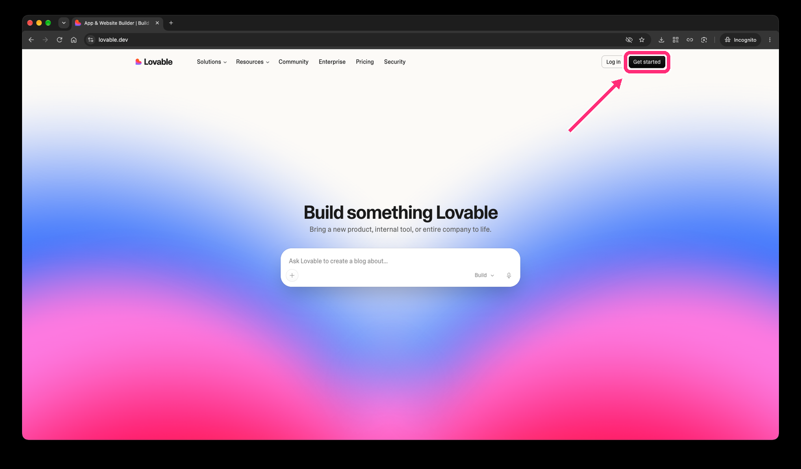

### Step 3: Create your free account

Choose **Continue with Google**, **Continue with Apple**, or enter an email address and password, then click **Create your account**.

The free plan needs no credit card. It gives you **5 build credits a day** (up to 30 a month). Daily credits reset at midnight UTC and don't carry over, so use them as you go.

{: .note }
You don't need GitHub for this guide, so you can ignore **Continue with GitHub** unless you already use it.

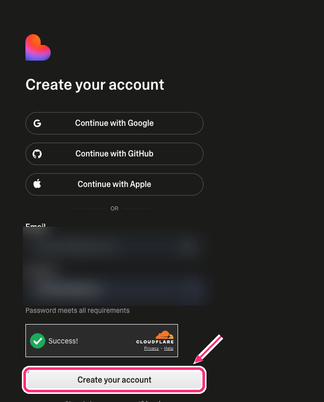

### Step 4: Answer the welcome questions

Lovable asks a few quick questions: **Pick your style** (Light or Dark), your name, which role fits you best, and how many people work at your company. Choose whatever fits, for example **Designer** and **Solo**, and click **Next** each time.

{: .tip }
Your answers only personalise Lovable. They don't change what you can build.

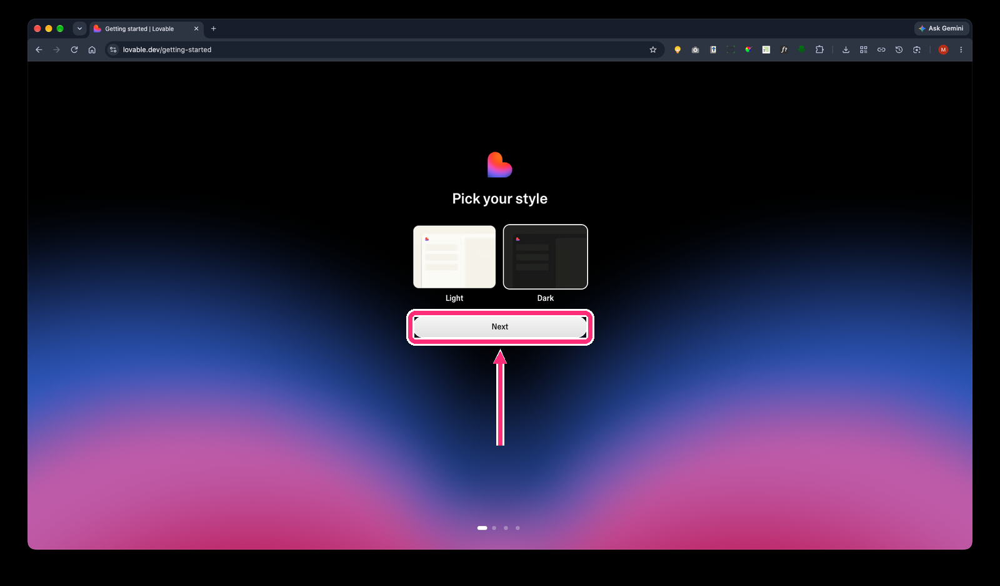

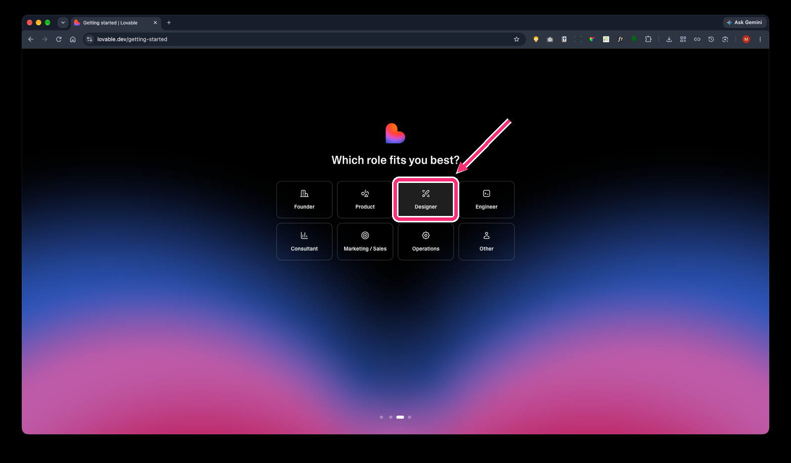

### Step 5: Find the prompt box

You land on the dashboard, which asks **"What's the vision?"**. The box in the middle is where you describe the app you want Lovable to build.

Check it is set to **Build** (bottom right of the box).

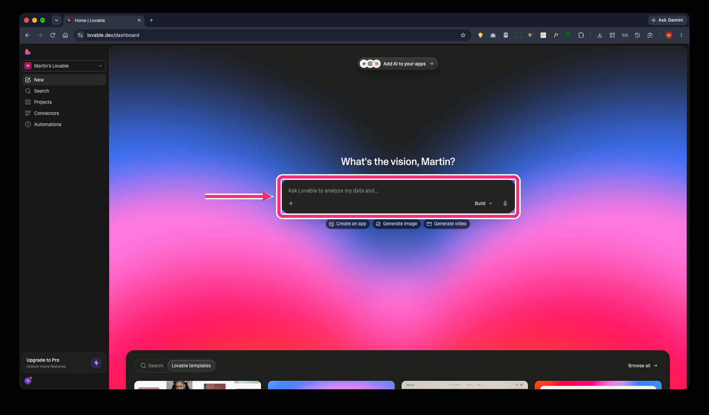

### Step 6: Paste a clear prompt

Describe your screens, navigation and look, and say it is for a **phone-sized screen**. A specific prompt gives a better first result and uses fewer credits. Here is the prompt we used for a wardrobe app called Closet:

```text
Build a mobile-first wardrobe organization app called "Closet" as a responsive web app, designed for a phone-sized screen (390px wide) with a persistent bottom tab bar for navigation. Use a clean, modern look: soft neutral background (warm off-white), one accent colour (deep teal), rounded cards, generous spacing, and a clear sans-serif font. Use sample data throughout so every screen looks populated from the start.

The app has exactly four screens:

1. HOME (Dashboard)
- Greeting header and today's date
- "Today's outfit suggestion" card showing a top, bottom and shoes as small image tiles, with a "Wear this" button and a "Shuffle" button
- Quick stats row: total items, outfits saved, items not worn in 30+ days
- "Recently added" horizontal scroll of 5 item cards

2. WARDROBE (Browse items)
- Search bar at the top
- Horizontally scrollable category chips: All, Tops, Bottoms, Dresses, Outerwear, Shoes, Accessories
- Two-column grid of item cards, each showing a photo placeholder, item name, colour dot and a favourite heart toggle
- Floating "+" button that opens the Add Item screen
- Tapping a card opens a bottom sheet with item details (category, colour, season, times worn, "Mark as worn" button)

3. ADD ITEM (Form)
- Photo upload area with a camera icon (placeholder is fine)
- Fields: item name, category dropdown, colour picker (swatches), season selector (Spring, Summer, Autumn, Winter, All-year), brand (optional), notes
- "Save item" button that adds the item to the Wardrobe grid and shows a confirmation toast
- Basic validation: name and category are required

4. OUTFITS (Saved looks)
- Segmented control at the top: "Saved" and "Planner"
- Saved: list of outfit cards, each showing the combined item thumbnails, outfit name and occasion tag (Work, Casual, Evening, Gym)
- Planner: a simple weekly view (Mon–Sun) where each day shows an assigned outfit or an "Add outfit" button
- "Create outfit" button that lets the user pick items from their wardrobe

Navigation: bottom tab bar with four icons and labels (Home, Wardrobe, Add, Outfits). Highlight the active tab in the accent colour. The Add Item screen is the third tab.

Technical notes: use React with Tailwind and shadcn/ui components, store all data in local state (no backend or login needed yet), and make sure touch targets are at least 44px and text meets accessible contrast.
```

If you paste a long prompt, Lovable turns it into an **attachment** above the box. Click it to check the text, then press the send arrow.

{: .tip }
If the first result is messy, build in stages: paste only the Home and Wardrobe screens first, then follow up with "Now add the Add Item screen", and so on.

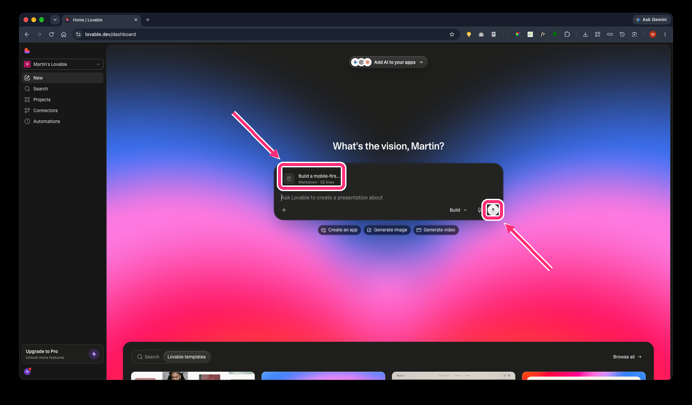

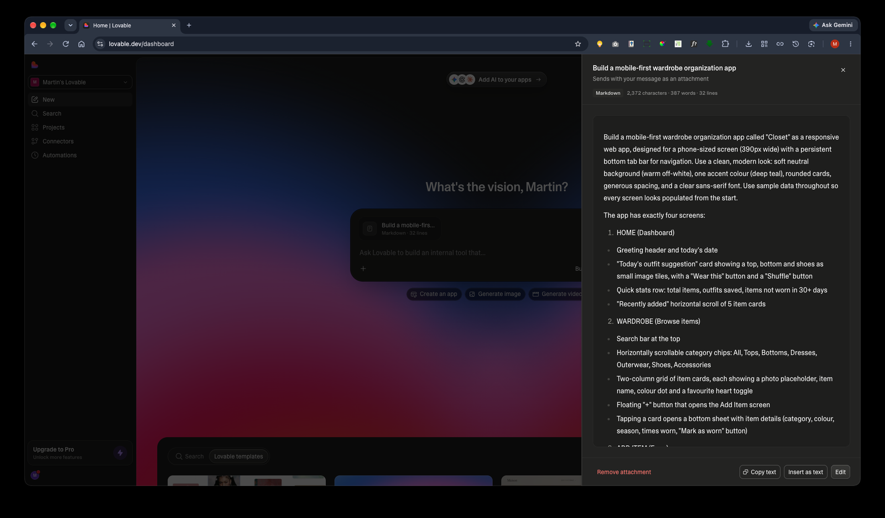

### Step 7: Check the preview

After a minute or two, your app appears in the **Preview** on the right. The chat on the left explains what Lovable built.

To see it at phone size, use the device toggle above the preview and choose **Mobile**.

Then improve it with **small requests, one change per message**, for example "Make the item cards rounder" or "Change the accent colour to dark green".

{: .note }
Read Lovable's notes in the chat. Ours warned: _"Nothing is saved yet: your changes are lost when the page reloads."_ That's normal for a prototype.

{: .tip }
If a change goes wrong, open **History** next to the project name and restore an earlier version.

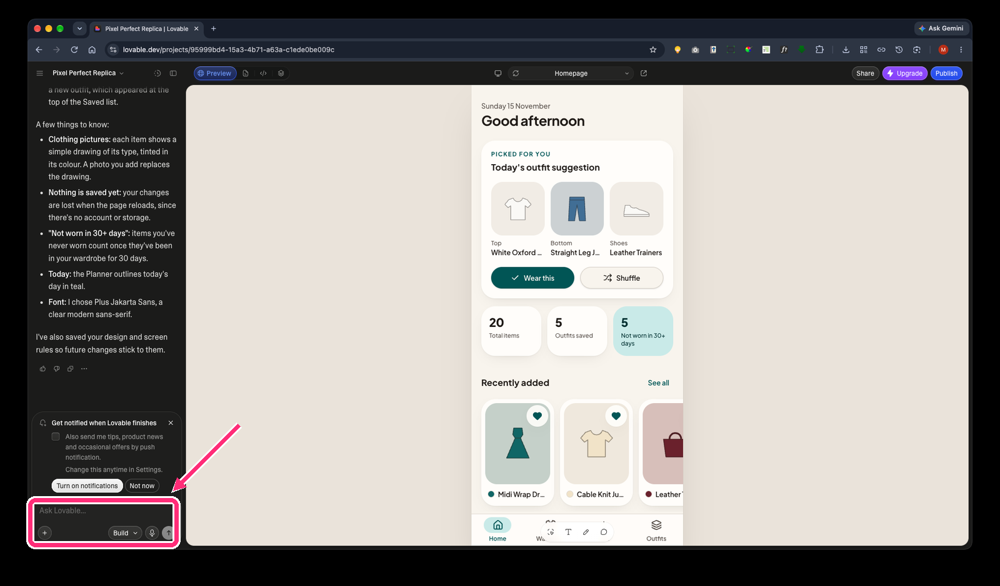

### Step 8: Check your credits

Click your workspace name (top left) to see how many **Credits** are left. For more detail, open **Workspace settings**, then **Plans & credit usage**.

- **Daily build credits**: your free credits for today
- **Credits**: any separate balance you have
- **Usage**: how many credits each project has used

{: .tip }
Small, focused requests cost less than big multi-part ones. Your numbers may differ from the screenshot.

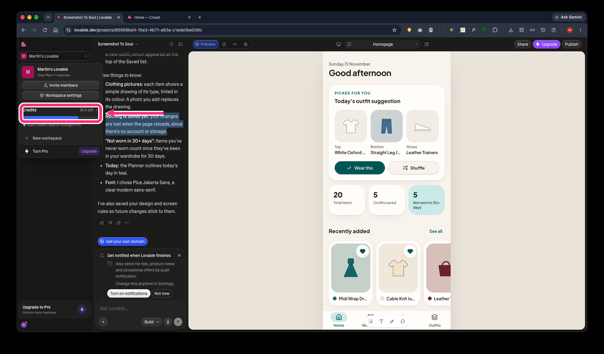

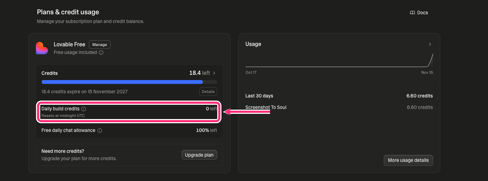

## Part 2: Publish

### Step 9: Click Publish

When you're happy with the app, click the blue **Publish** button at the top right of the editor.

{: .warning }
Use the **Publish** button, not a chat message. Publishing from the button doesn't use credits, and it works even when your credits are at zero.

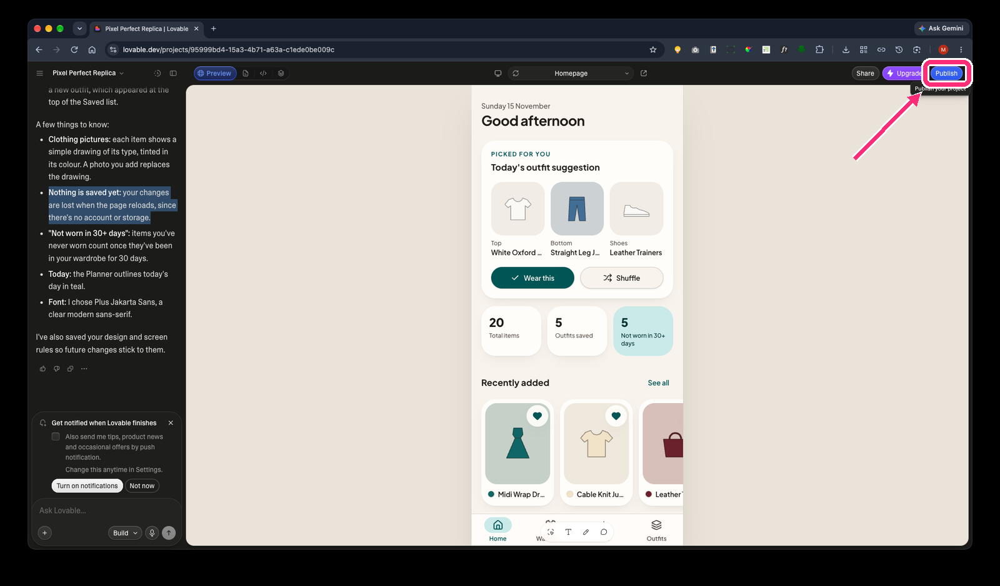

### Step 10: Check your website address

The panel shows **Not published** and your **Website URL**, something like `your-project.lovable.app`. Click the pencil icon if you want to change the name.

Below it you can see who can view the site (**Visible to anyone with the link**) and a security check (**No security issues found**).

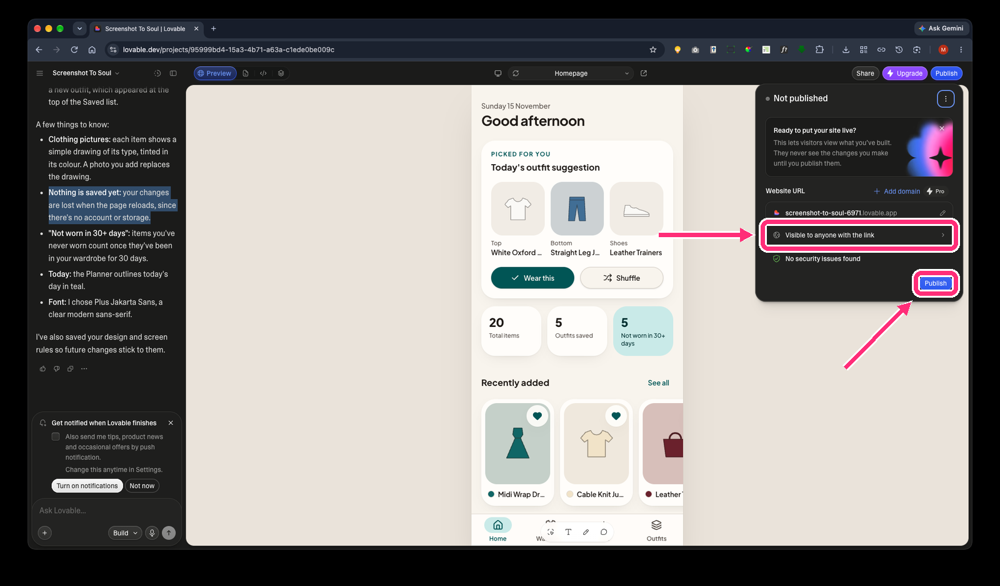

### Step 11: Choose who can view it

Click **Visible to anyone with the link** to open **Who can view your site?**. For user testing, choose **Public** (anyone with the link) so your testers can open it. Click **Done**.

{: .note }
The workspace-only option needs a Business plan, so on the free plan it's greyed out.

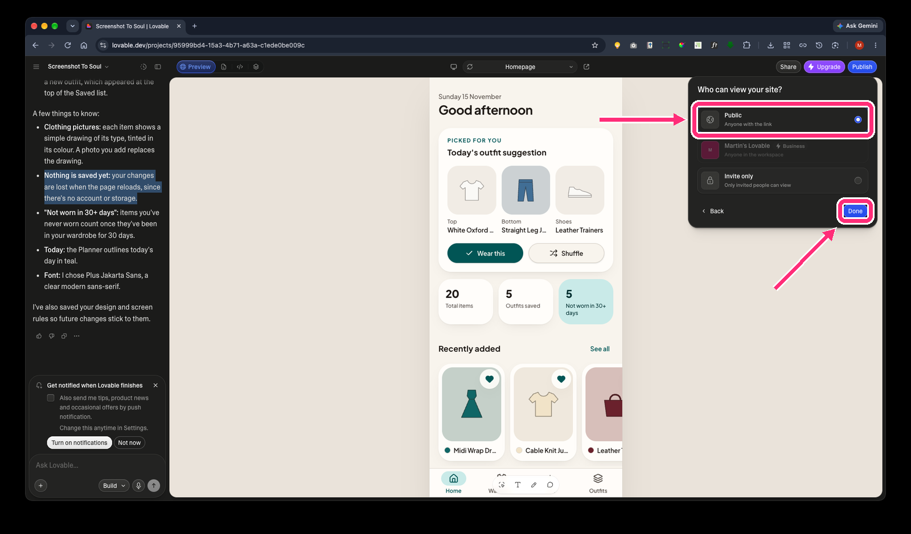

### Step 12: Publish and visit your site

Click **Publish**. You'll see **Publishing project…**, then **Your website is live**. Click **Visit site** to open it in a new tab.

The live site is a **snapshot** of the moment you published. Later edits only appear after you publish again.

{: .tip }
There's no save button in Lovable. Every change is stored in your account automatically.

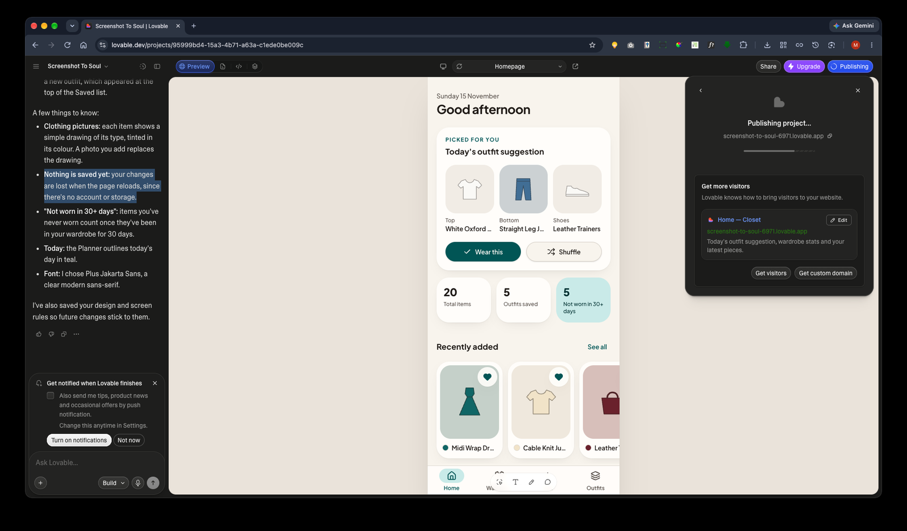

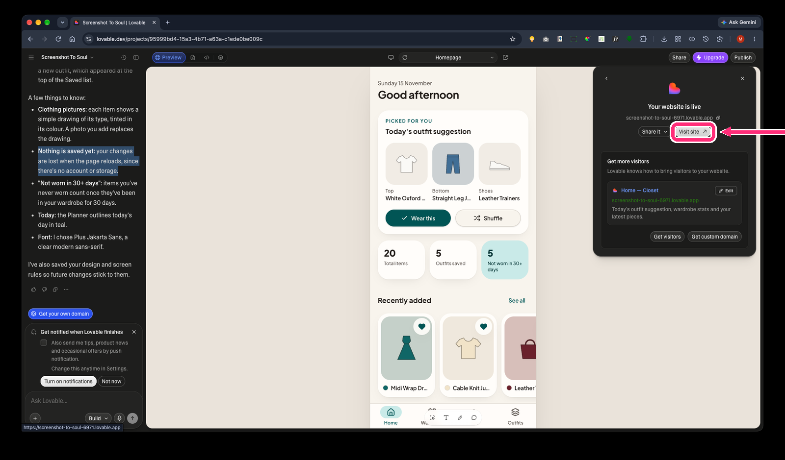

### Step 13: Send it to your phone with a QR code

On the live site in Chrome, click the **QR code** icon in the address bar (or right-click the page and choose **Create QR code for this page**). Scan the code with your phone's camera to open the app there.

You can also just type the `lovable.app` address on your phone, or send it to yourself.

{: .warning }
Only use a QR code for the **published** address, as shown here. The QR code in Lovable's preview opens a development link, which won't work properly as a home-screen app.

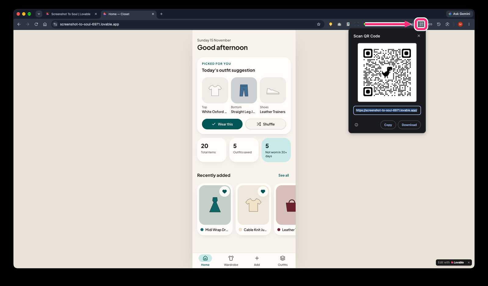

### Step 14: Come back later from Projects

You can close the browser at any time. To carry on later:

1. Go to lovable.dev and sign in.
2. Click **Projects** in the sidebar.
3. Open your project. It shows a **Published** label.

{: .tip }
If the preview says **Still building?** when you return, click **Keep building**. Nothing is lost.

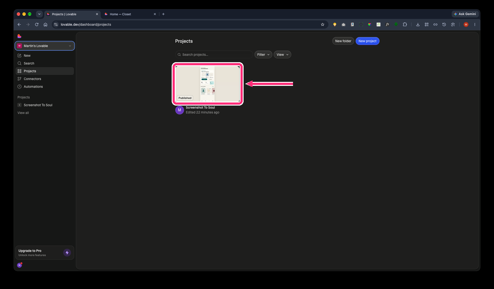

## Part 3: Put it on your phone

### Step 15: Open the published address on your phone

Open your `lovable.app` address in **Chrome** on your Android phone, either from the QR code or by typing it in.

On an iPhone, use Safari and follow the [iPhone steps](#iphone-add-the-app-to-your-home-screen) below instead.

<p align="center">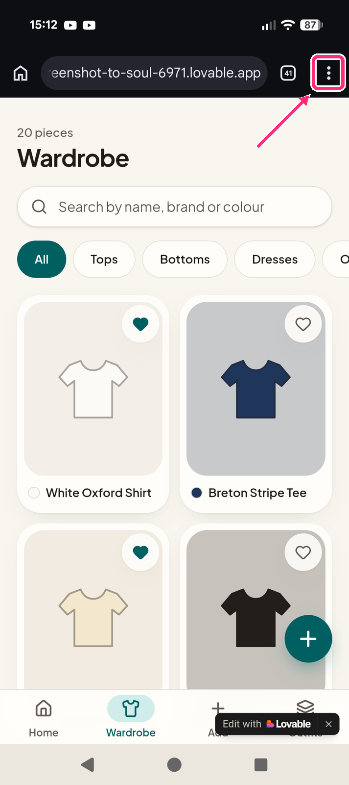</p>

### Step 16: Open the Chrome menu

Tap the **three-dot menu (⋮)** at the top right, then tap **Install and create shortcut**.

{: .note }
On some phones this is called **Add to Home screen** or **Install app**.

<p align="center">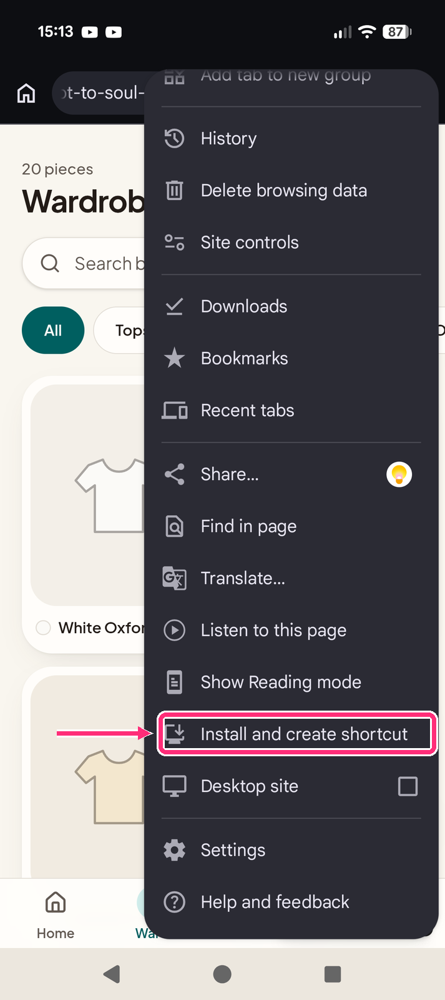</p>

### Step 17: Install it as an app

Choose **Install page as app**, not _Create shortcut_. Check the name, then tap **Install**.

{: .tip }
**Install page as app** opens full screen like a real app. _Create shortcut_ just opens Chrome, with the address bar showing.

<p align="center">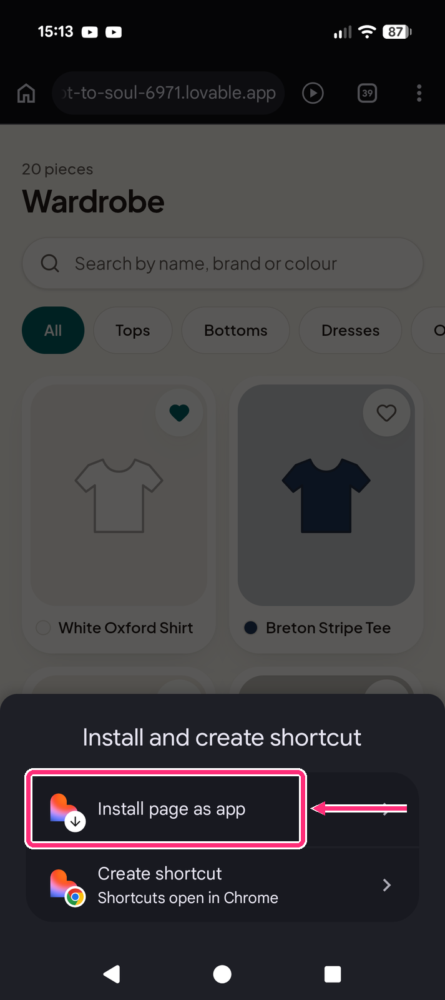</p>

<p align="center">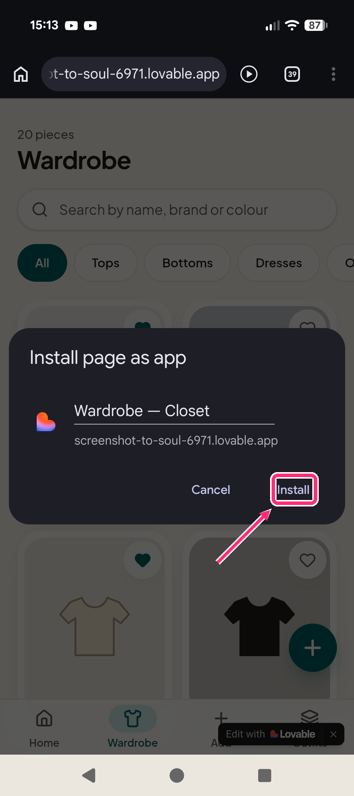</p>

### Step 18: Find the icon on your home screen

The app now has its own icon on your home screen, next to your other apps.

{: .note }
The icon may be a generic Lovable one. That's fine for a prototype.

<p align="center">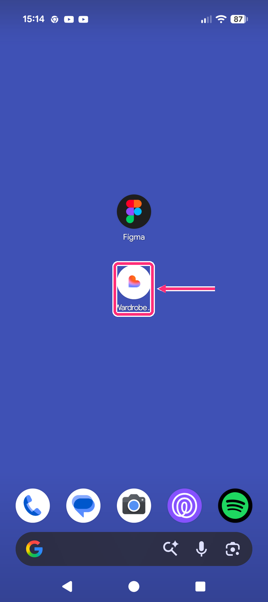</p>

### Step 19: Launch it like a real app

Tap the icon. The app opens **full screen, without the browser address bar**, so it looks and feels like a real app. You're ready to test it with users.

{: .tip }
Before a test session, go through the app yourself once on your phone to check every screen works.

<p align="center">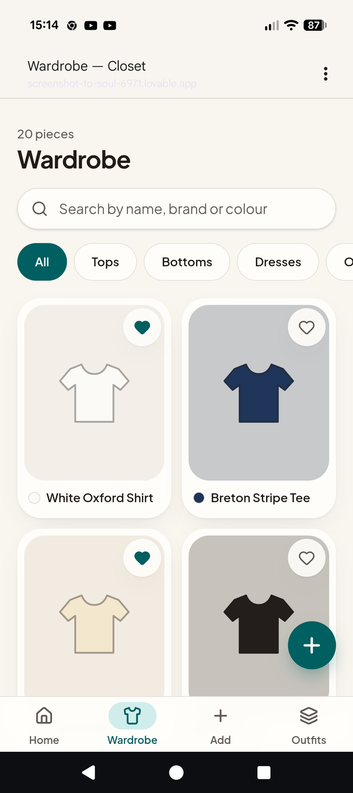</p>

---

## After the steps

### iPhone: add the app to your home screen

1. Open your published `lovable.app` address in **Safari**. Chrome on iPhone can't add home-screen shortcuts.
2. Tap the **Share** button (a square with an arrow pointing up).
3. Scroll down and tap **Add to Home Screen**.
4. Tap **Add**. The icon appears on your home screen and opens without the address bar.

### Update the app after changes

1. Make your changes in the Lovable chat.
2. Click **Publish**, then publish your changes. A dot on the Publish button means you have changes that aren't live yet.
3. On your phone, close the app fully and open it again. If you still see the old version, reload the page.

You don't need to add the app to your home screen again.

### Share with your test users

Give testers your published address and the phone steps above (Steps 15–19, or the iPhone steps). A Public site can be seen by anyone with the link. You can change this from the visibility option in the Publish panel.

{: .tip }
Test data resets. The Closet app keeps changes in the page only, so anything a tester adds disappears when the page reloads. That's fine for a test, but tell your testers so they aren't surprised.

### Troubleshooting

| Problem | What to try |
|:--------|:------------|
| Daily credits are at 0 | Wait for the reset at midnight UTC. Your project and published site are not affected. |
| The live site shows the old version | Publish your changes, then close and reopen the app on your phone. |
| No "Add to Home Screen" on iPhone | Open the link in **Safari**, not Chrome. |
| The app opens with a browser address bar | Remove the icon and add it again from the published address, choosing **Install page as app**. |
| The preview says "Still building?" | Click **Keep building**. Lovable pauses the preview when you're away and nothing is lost. |
| A change broke the app | Open **History** next to the project name and restore an earlier version. |

### Good to know

- **Free plan limits:** no custom domain, and the code is read-only.
- **It's a website, not a native app:** no app store listing and no push notifications.
- **Lovable names your project for you** (ours was "Screenshot To Soul"). You can rename it from the project name menu.

**Sources**

- [Lovable pricing](https://lovable.dev/pricing)
- [Plans and credits](https://docs.lovable.dev/introduction/plans-and-credits)
- [Publish your project](https://docs.lovable.dev/features/publish)
- [Version history](https://docs.lovable.dev/features/projects/history)
