# Getting started with Google Stitch
{: .no_toc }

Turn a prompt, a sketch or a screen capture into a clickable app or web design, then share a link so people can test it.

**Time:** about 30 minutes · **Steps:** 19 · No coding needed · Works with any Google account

[Open Stitch](https://stitch.google.com/){: .btn .btn-primary .fs-5 .mb-4 .mb-md-0 .mr-2 } [Stitch documentation](https://stitch.google.com/docs/learn/overview/){: .btn .fs-5 .mb-4 .mb-md-0 }

  
<strong>Start here: a 40-second introduction</strong>

  <video controls preload="metadata" style="width:100%;" poster="assets/stitch/video/intro-poster.jpg">
    <source src="assets/stitch/video/intro.mp4" type="video/mp4">
    <track kind="captions" src="assets/stitch/video/intro.vtt" srclang="en-GB" label="English captions" default>
    
Your browser cannot play this video. The steps below cover everything it says.

  </video>
  
<small>A short voice-over introduction to Stitch. Captions are available from the video controls.</small>

  

    Table of contents
  

  {: .text-delta }
1. TOC
{:toc}

---

## 1. Watch the overview video

Press play to watch a short screen recording of Stitch building a four-screen app from a single prompt. It lasts about a minute and three quarters. The steps below then take you through every stage slowly, so you can follow along yourself.

{: .highlight }
> **Tip:** The video has no sound, so everything it shows is described in the steps below. Use the video controls to pause, replay or go full screen.

<video controls preload="metadata" style="width:100%;" poster="assets/stitch/video/poster.jpg" aria-label="Silent screen recording: Stitch builds a four-screen Closet wardrobe app from one prompt.">
  <source src="assets/stitch/video/stitch-overview.mp4" type="video/mp4">
  
Your browser cannot play this video. The steps below describe everything it shows.

</video>

*Overview video (about 1 minute 45 seconds, no sound).*

---

## 2. Open Stitch

Go to [stitch.google.com](https://stitch.google.com/) in your browser. You will see the **Design at the speed of AI** page. Click **Try now** at the top right.

{: .highlight }
> **Tip:** The official documentation lives at [stitch.google.com/docs](https://stitch.google.com/docs/learn/overview/). Stitch is marked **Beta**, so buttons may move or be renamed over time.

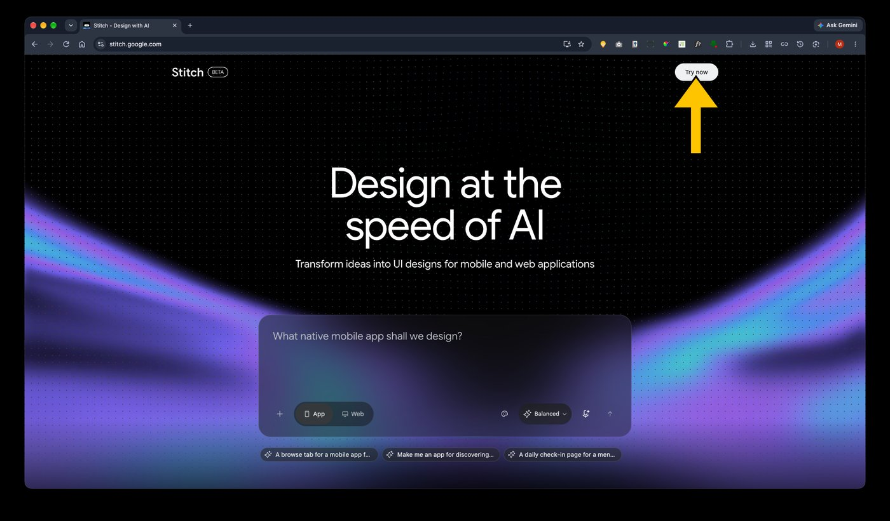

---

## 3. Sign in and find the home screen

Sign in with your Google account. Most people already have one, and if you don't, you can sign up for a new account. You will land on **Welcome to Stitch..** Your earlier work is listed under **My Projects** on the left, and **Docs** is at the top right.

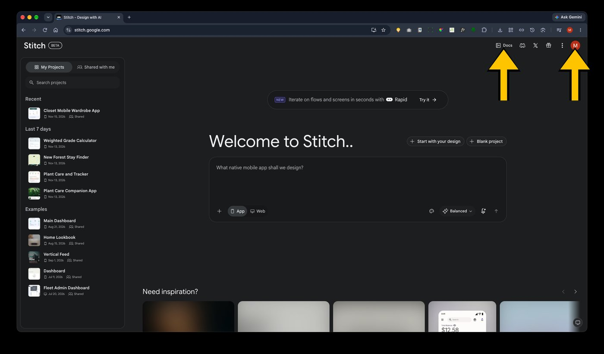

---

## 4. Choose how to start

You can begin in three ways. Click the **+** at the bottom left of the prompt box, then choose **Upload Files** to add a **sketch** or a **screen capture**. Choose **Website URL** to start from an existing site. Or skip the menu and simply type a **prompt** in the box. **Start with your design** and **Blank project** are also at the top right.

{: .highlight }
> **Tip:** A photo of a hand-drawn sketch works well, and so does a screen capture of an existing app or site that you want to redesign. Upload one, then add a short prompt saying what you want changed.

---

## 5. Add a prompt

Click in the box and type or paste your prompt. A good prompt names the app, says who it is for, describes the look, and lists the exact screens you want. If you are stuck, you have two options. Type a rough idea and use **Enhance prompt** in the **+** menu to let Stitch's own AI improve it. Or ask another AI such as Gemini, Claude or ChatGPT to write the prompt for you, then paste it in.

{: .highlight }
> **Tip:** Ask the other AI something like: *Write a detailed prompt for a UI design tool for an app called [name]. Describe the look and feel, and list exactly four screens with what is on each one.*

{: .note }
> **Why this matters:** The more specific your prompt, the less Stitch has to guess, and the closer the first result will be to what you pictured.

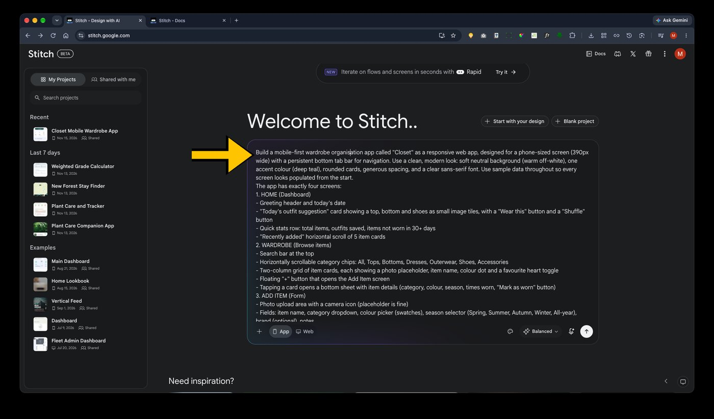

---

## 6. Choose App or Web

At the bottom left of the box, pick **App** for a phone-sized design or **Web** for a website-style design. The highlighted button is the one that is selected. You can leave the **Balanced** menu on its default setting.

{: .warning }
> **Warning:** Choose before you generate. The App or Web setting sets the shape of the screens Stitch creates.

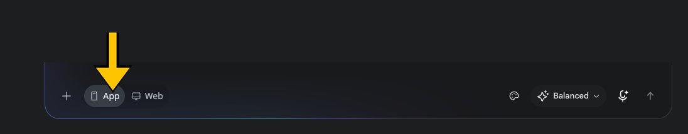

---

## 7. Click Generate

Click the round **up-arrow** button at the bottom right of the box. Its tooltip reads **Generate**. Stitch now builds your design from your words. People call this *vibe coding*: you describe what you want in plain English and the AI does the building.

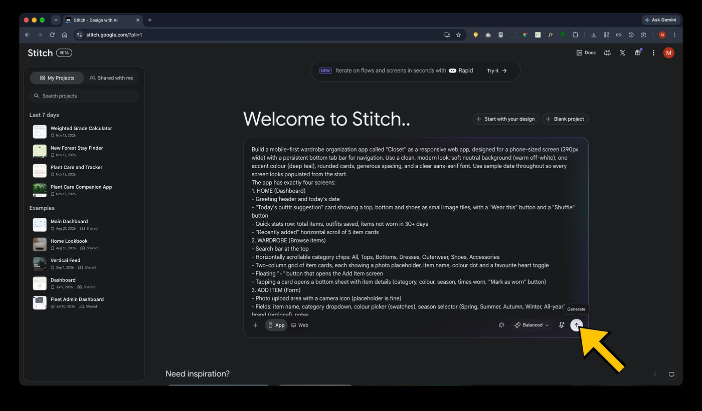

---

## 8. Watch Stitch build

A new project opens on a large canvas. The dark **chat panel** on the left shows your prompt and what Stitch is doing, while three moving dots show that it is working. The canvas stays empty for a short while.

{: .warning }
> **Warning:** Keep the tab open while Stitch works, so you can see straight away when it has finished.

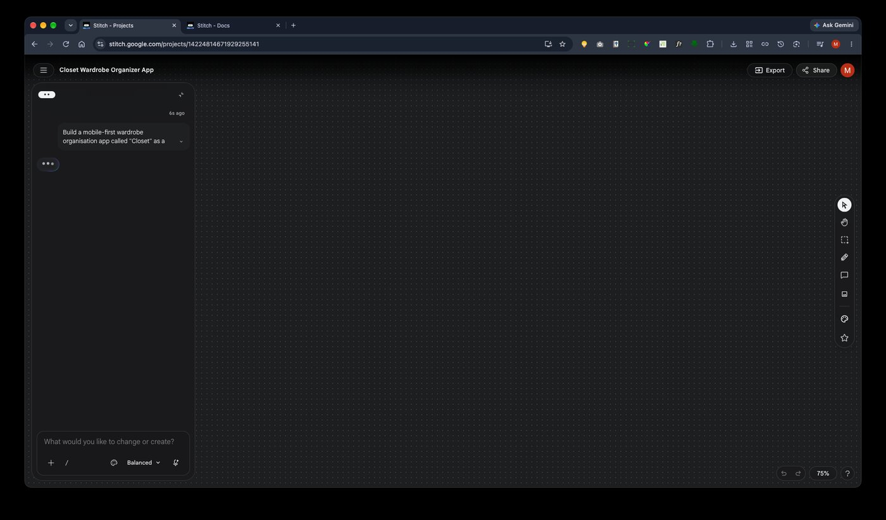

---

## 9. Stitch creates a style sheet

First, Stitch creates a **style sheet**, also called a design system. It sets the colours, fonts, buttons and icons that every screen will share. Here you can see colour swatches for **Primary**, **Secondary**, **Tertiary** and **Neutral**, plus large **Aa** font samples.

{: .note }
> **Why this matters:** A shared style sheet is why all your screens look like one product, instead of five unrelated pictures.

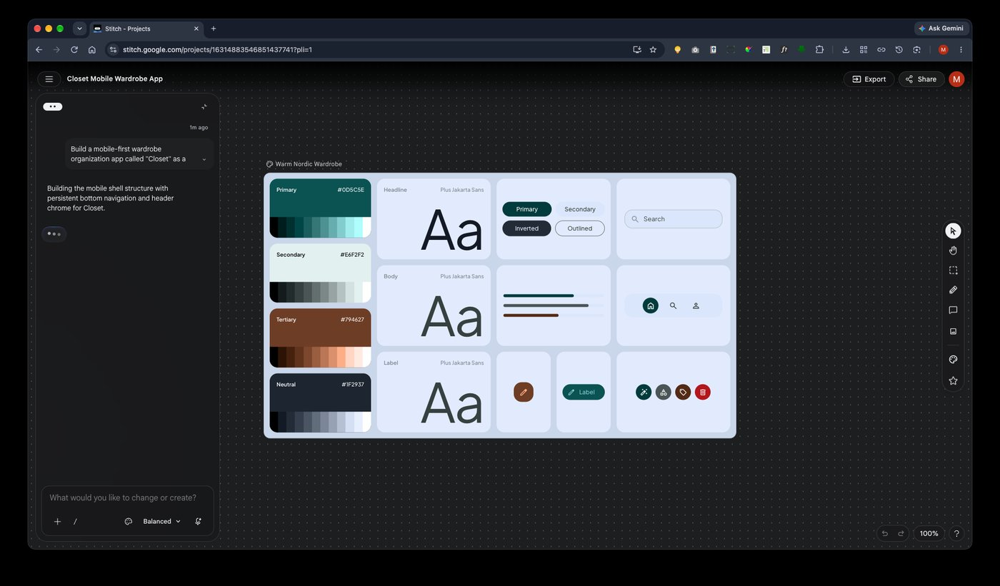

---

## 10. Stitch creates your screens

Next, Stitch builds the screens you asked for, one by one. The chat panel tells you which screens it is working on. In this example it is making **Home Dashboard**, **Wardrobe Browser**, **Add Item Form** and **Outfits Planner**.

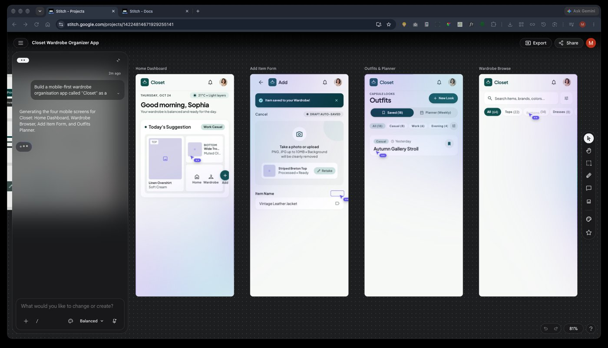

---

## 11. Review your finished design

When Stitch finishes, the canvas shows your style sheet followed by all your screens side by side. Use the zoom control at the bottom right to look closer. Check each screen against your prompt and note anything you would like to change.

{: .highlight }
> **Tip:** The first result is a starting point. It is normal to make a few edits before you are happy.

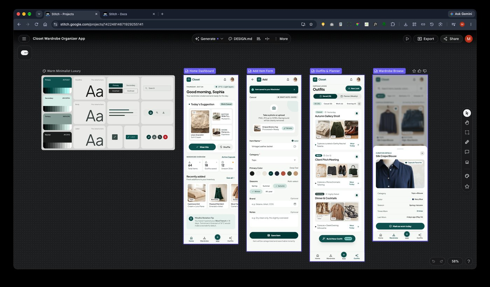

---

## 12. Edit the design

Click a screen to select it. Its name appears as a small chip in the chat box. Type what you want to change, in plain English, such as *make the Wear this button bigger*, then send it. The toolbar at the top also has **Generate**, **Modify**, **Preview** and **More** menus.

{: .warning }
> **Warning:** Finish your edits before you share. That way your testers see the version you meant them to see.

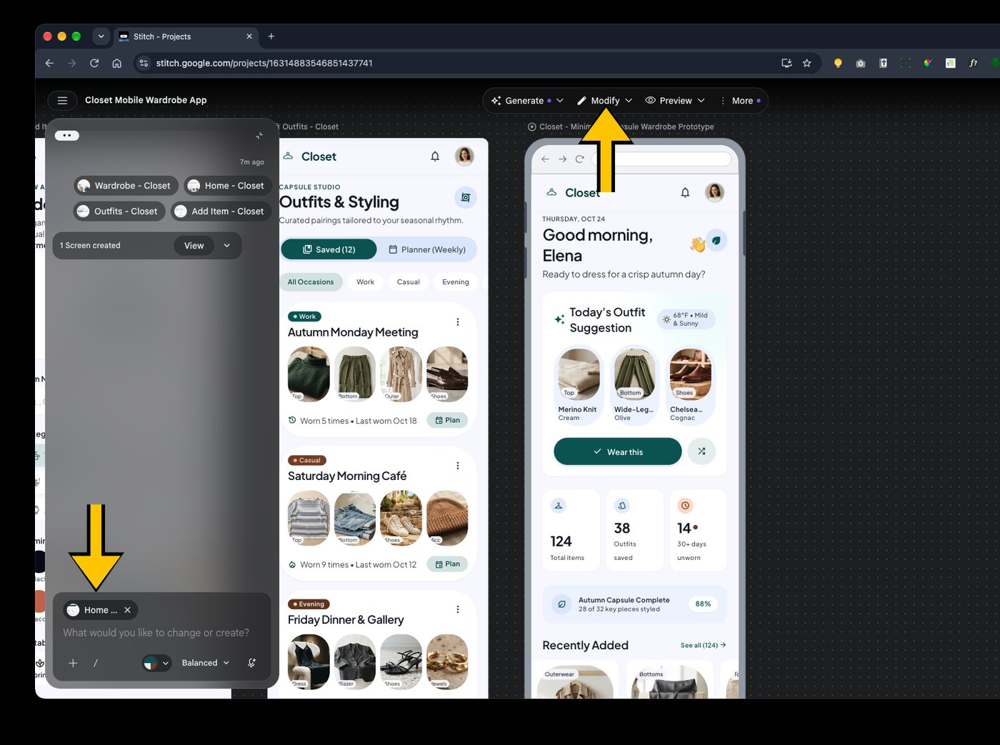

---

## 13. Turn it into a prototype

Click the **Play** icon at the top right, next to **Export** and **Share**. Its tooltip reads **Connect and Preview with Instant Prototypes**. Stitch links your screens together so they behave like a real app.

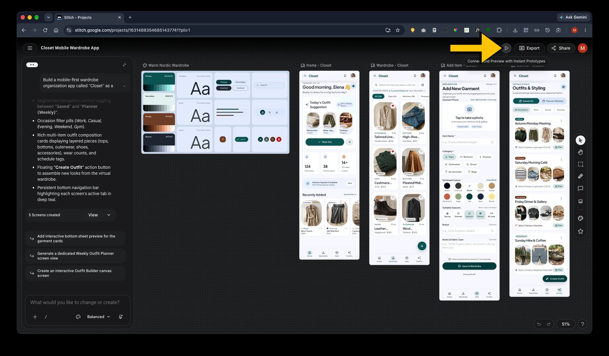

---

## 14. Click through the prototype

The prototype opens with **Preview** and **Edit** tabs at the top. Your screens are listed on the left under **Screens in prototype**. Click the buttons in the bottom tab bar of the phone, which have dashed outlines, to move between screens. Use **Add Screen** or **Imagine a new screen** if you need more.

---

## 15. Open Share and set access

Click **Share** at the top right. In the **General Access** box, open the drop-down and choose **Anyone with link**, rather than **Only people invited**. This means your testers can open the prototype without being invited by email.

{: .warning }
> **Warning:** Anyone who has the link can open the prototype. Don't put private or personal information in a design you plan to share this way.

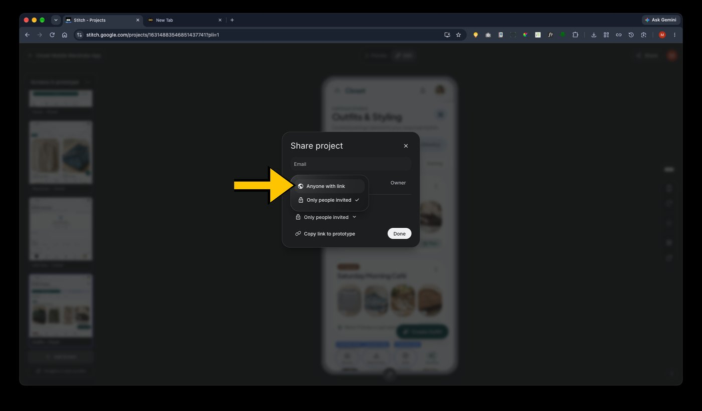

---

## 16. Copy the link for user testing

Check that **General Access** shows **Anyone with link** and **Viewer**. Then click **Copy link to prototype** and click **Done**. Paste the link into an email, a Teams message or your Moodle page for your testers.

{: .highlight }
> **Tip:** Open the link yourself in a private browser window first, to check that it works for someone who is not signed in.

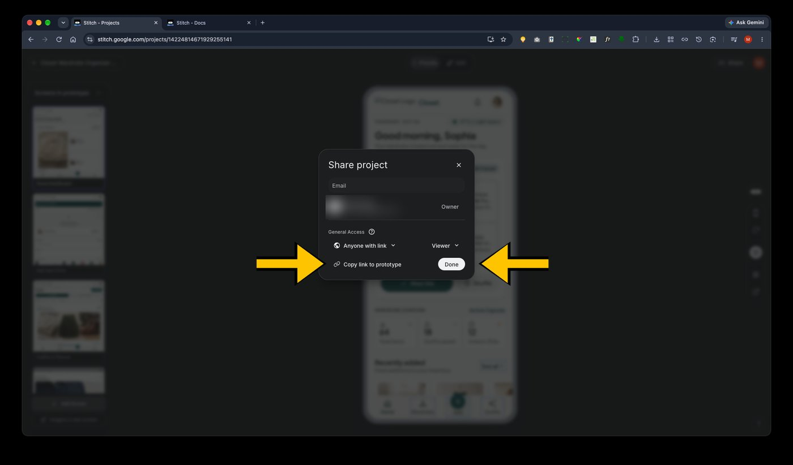

---

## 17. Open the link on a phone

When someone opens your link, they see a clean preview page with the prototype in a phone frame. The **Show QR Code** button at the top gives a code that testers can scan with a phone camera to open the prototype on their phone. What happens next depends on the type of phone, as the next two steps explain.

{: .note }
> **Why this matters:** Testing on a real phone shows you things a laptop screen hides, such as buttons that are too small to tap.

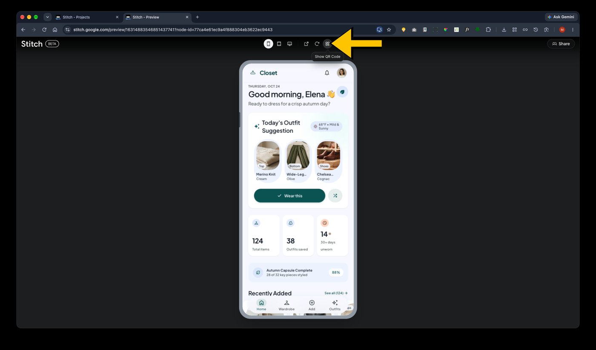

---

## 18. On Android: use the Stitch app

If your testers have an **Android** phone, they can download the **Stitch app** from the app store on the phone (Google Play) and open the prototype there. This is the Closet prototype running on an Android phone.

{: .highlight }
> **Tip:** Ask testers to install the app before the session, so no time is lost on the day.

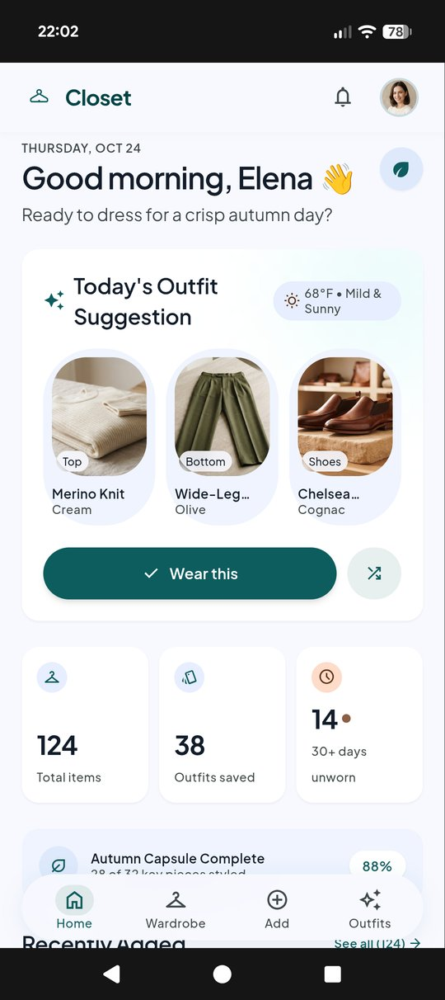

---

## 19. On iPhone: use Safari and add a shortcut

As far as we know, there is no Stitch app for iPhone, so testers open the link in a browser such as **Safari**. To make it open full screen, like an app, they tap the **Share** button in Safari, choose **Add to Home Screen**, then tap **Add**. The new shortcut icon on the home screen opens the prototype without the browser bars.

{: .warning }
> **Warning:** Check the app store before your session, in case a Stitch app for iPhone has been released since this guide was written.

---
